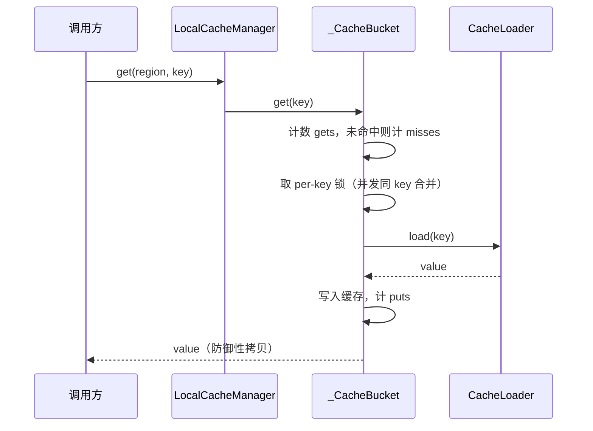
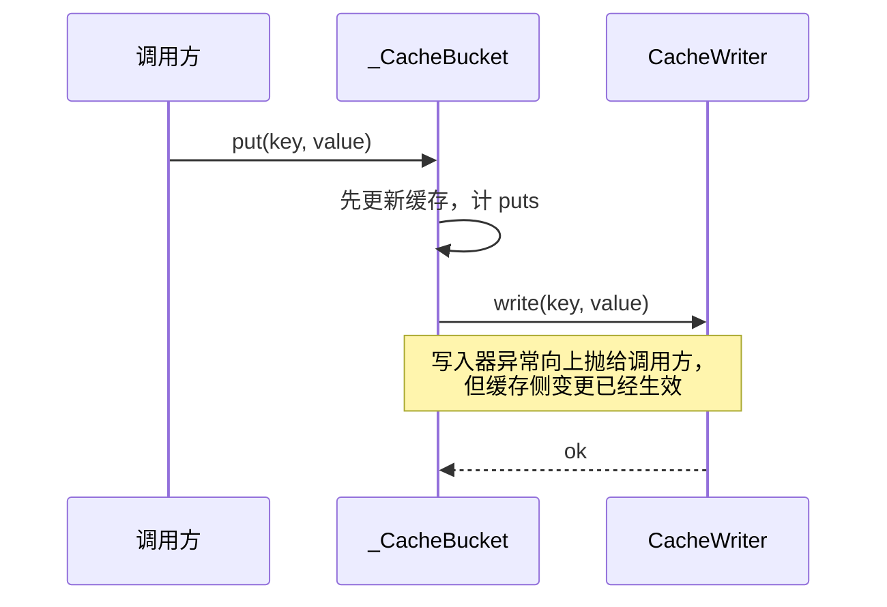
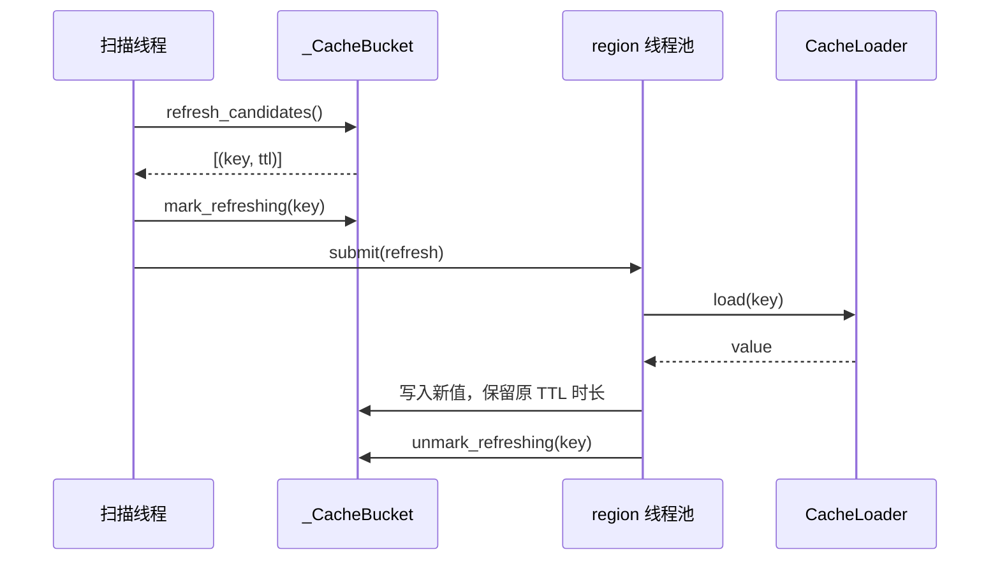

# atlas-richie-cache-core

框架无关的分布式缓存平台底座：多态契约（ops / function / contracts）、静态门面
（`GlobalCache`、`LocalCache`）、Holder（`GlobalCacheManager`、`LocalCacheManager`）、
共享工具，以及基于 `cachetools` 的进程内本地缓存管理器。

后端无关：具体后端包（`atlas-richie-cache-redis`、未来的
`atlas-richie-cache-dragonfly`、内存测试替身等）实现 `ProviderRegistrar` SPI，
并在启动时向框架的互斥保护的 `CacheRegistry` 注册自己。静态门面 `GlobalCache`
随后把调用委派给当前生效的后端。

零后端依赖：本包**不**安装 `redis-py`。运行时依赖只有 `cachetools`、`pydantic`、
`pydantic-settings`。

## 📖 目录

- [🎯 组件概览](#-组件概览)
    - [核心特性](#核心特性)
- [🏗️ 架构设计](#️-架构设计)
    - [包结构](#包结构)
    - [L1 能力接线](#l1-能力接线)
    - [后端契约](#后端契约)
    - [防雪崩 jitter](#防雪崩-jitter)
- [🚀 快速开始](#-快速开始)
    - [1. 声明依赖](#1-声明依赖)
    - [2. 进程内缓存](#2-进程内缓存)
    - [3. 接入 Redis 后端](#3-接入-redis-后端)
- [📚 接口参考](#-接口参考)
    - [L1 能力契约](#l1-能力契约)
    - [LocalCacheManager 能力 API](#localcachemanager-能力-api)
- [🔧 L1 能力](#-l1-能力)
    - [统计（statistics）](#统计statistics)
    - [按值存储（store-by-value）](#按值存储store-by-value)
    - [Read-through](#read-through)
    - [Write-through](#write-through)
    - [Refresh-ahead](#refresh-ahead)
- [🔀 前缀路由契约](#-前缀路由契约)
    - [key 约定](#key-约定)
    - [路由契约 API](#路由契约-api)
    - [为什么分成两半](#为什么分成两半)
- [⚙️ 配置参考](#️-配置参考)
    - [CacheDefinition 字段](#cachedefinition-字段)
    - [与 Java 的字段对位](#与-java-的字段对位)
    - [三处刻意差异](#三处刻意差异)
- [🔧 故障排查](#-故障排查)
- [📎 ⏱️ 时序图参考](#-️-时序图参考)
    - [Read-through 未命中回源](#read-through-未命中回源)
    - [Write-through 写回](#write-through-写回)
    - [Refresh-ahead 后台刷新](#refresh-ahead-后台刷新)

## 🎯 组件概览

本包同时提供**分布式**与**进程内**两层缓存的底座：

- 分布式侧只定义契约（Protocol）与注册机制，具体存储由后端包实现；
- 进程内侧（L1）是一套**完整实现**——过期策略、容量淘汰、统计、
  read-through / write-through / refresh-ahead 都在本包内闭环。

### 核心特性

- ✅ **L1 过期策略完整对齐 JSR-107**：CREATED / ACCESSED / MODIFIED / TOUCHED / ETERNAL
  五种策略的"创建 / 读 / 写"触发语义逐条落地，`contains_key` 不算访问事件
- ✅ **L1 统计**：命中 / 未命中 / 读写 / 删除累计计数，另把"过期淘汰"与
  "容量淘汰"拆成两个独立计数器——本地缓存必须能区分这两种淘汰原因
- ✅ **Read-through**：未命中回源并写回缓存；同一 key 的并发未命中合并为一次回源
- ✅ **Write-through**：缓存变更同步回写数据源，顺序与 JSR-107 一致（先改缓存、再调写入器）
- ✅ **Refresh-ahead**：条目临近过期时后台异步刷新，热 key 不在到期瞬间付回源延迟
- ✅ **按值存储可开关**：读写都做防御性拷贝是默认行为，按引用存储作为显式关闭开关
- ✅ **多实例路由契约**：前缀路由的 key 解析与前缀表放在 core（零第三方依赖），连接那一半留在后端包
- ✅ **零第三方依赖守护**：`tools/dependency-check/check_core_imports.py` 守住 core 不引入后端依赖
- ✅ **后端零耦合**：后端实现 `ProviderRegistrar` SPI 并注册到 `CacheRegistry`，
  core 不反向依赖任何后端

## 🏗️ 架构设计

### 包结构

```
atlas_richie/cache_core/
├── ops/           # 16 个底层 ops Protocol
├── function/      # 11 个高层 function Protocol
├── contracts/     # 5 个横切契约（lock、pubsub、keyspace ...）
├── commons/       # cache_key_utils、geo_point_result
├── routing/       # 多实例前缀路由契约（key 解析 + 前缀表，零第三方依赖）
├── enums/         # CacheProvider、KeyTypeEnum、L2CachingRegion
├── config/        # BloomFilterConfig
├── operations/    # BoundedQueue、BoundedStack、容量上限
├── local/         # 进程内缓存（cachetools，非 JSR-107 实现）
│   ├── config/    # LocalCacheProperties、CacheDefinition
│   ├── enums/     # CacheProvider、ExpiryPolicy
│   ├── manage/    # LocalCache、LocalCacheManager、CacheLoader/Writer/Statistics
│   └── util/      # DefensiveCopyUtils
├── registry/      # ProviderRegistrar SPI + CacheRegistry 互斥注册
├── facade/        # GlobalCache 静态门面
└── holder/        # GlobalCacheManager 每实例 Holder
```

### L1 能力接线

`LocalCacheManager` 为每个 region 维护一个 `_CacheBucket`。能力开关在 bucket
创建时按"region 覆盖 → `default_*` 回退"的顺序解析一次，之后该 bucket 的行为固定：

```mermaid
graph TB
    P[LocalCacheProperties] -->|cache_definitions[region]| D[CacheDefinition]
    P -->|default_*| D
    D --> B[_CacheBucket 创建]

    B --> S[statistics_enabled]
    B --> V[store_by_value]
    B --> R[read_through]
    B --> W[write_through]
    B --> A[refresh_ahead]

    M[LocalCacheManager] -->|register_loader| R
    M -->|register_writer| W
    M -->|stats / all_stats| S
    M -.->|后台扫描线程| A

    R --> L[CacheLoader]
    W --> C[CacheWriter]
    A --> L
```

- loader / writer 是**注册的可调用对象**，不是配置里的类名字符串——
  Python 没有"按类路径反射"的惯用法；
- 注册动作对**已存在的 bucket 立即生效**，不需要重建管理器；
- `refresh_ahead` 由管理器的一个扫描线程 + 每 region 一个线程池驱动，
  线程数取该 region 的 `refresh_ahead_threads`。

### 后端契约

后端必须实现 `ProviderRegistrar`（16 ops + 1 infrastructure + 11 functions +
2 meta accessors）并在启动时调用 `CacheRegistry.register(...)`。第二次注册会抛
`StateError`；要换后端请先 `unregister()`。

### 防雪崩 jitter

`CacheFunction.get_random_extra_millis()` 是全平台唯一的防雪崩抖动实现：返回
`[60_000, 600_000]` 毫秒区间内**离散**的整分钟偏移（10 个等概率取值），
对位 Java 的 `ThreadLocalRandom.current().nextInt(1, 11) * 60_000L`。

写缓存 TTL 的后端必须调用它，不要自带一份分布不同的副本——参考接线见
`atlas-richie-cache-redis`（其中两处刻意保留精确 TTL：底层原始 ops 与负缓存标记）。

## 🚀 快速开始

### 1. 声明依赖

```toml
[dependencies]
atlas-richie-cache-core = "*"
```

### 2. 进程内缓存

```python
from atlas_richie.cache_core.local import (
    CacheDefinition,
    ExpiryPolicy,
    LocalCache,
    LocalCacheProperties,
)

LocalCache.configure(
    LocalCacheProperties(
        cache_definitions={
            "session": CacheDefinition(
                expiry_policy=ExpiryPolicy.ACCESSED,
                ttl_millis=300_000,
                statistics_enabled=True,
            )
        }
    )
)

LocalCache.put("session", "u:42", {"name": "richie"})
LocalCache.get("session", "u:42")
```

### 3. 接入 Redis 后端

```python
from atlas_richie.cache_core import GlobalCache, CacheRegistry
from atlas_richie.cache_redis import RedisProviderRegistrar

registrar = RedisProviderRegistrar(
    redis_url="redis://127.0.0.1:16379/0",
    namespace="atlas-richie",
)
CacheRegistry.register(GlobalCacheManager(registrar))

GlobalCache.value_ops().set("user:42", {"name": "richie"})
value = GlobalCache.value_ops().get("user:42", dict)
```

## 📚 接口参考

### L1 能力契约

```python
from atlas_richie.cache_core.local import (
    CacheLoader,      # read-through 契约：load(key) / load_all(keys)
    CacheStatistics,  # 不可变统计快照
    CacheWriter,      # write-through 契约：write(key, value) / delete(key)
)
```

| 契约 | 方法 | 说明 |
|------|------|------|
| `CacheLoader` | `load(key) -> value \| None` | 返回 `None` 表示无值，不写入缓存 |
| `CacheLoader` | `load_all(keys) -> Mapping` | 批量回源；映射里缺的 key 视为无值 |
| `CacheWriter` | `write(key, value)` | 把新值回写数据源 |
| `CacheWriter` | `delete(key)` | 从数据源删除 key（**必填**） |

> `CacheWriter.delete` 是必填的：缓存删了条目却不同步删数据源，会留下永远不会
> 消失的脏数据。这类配置错误必须在注册时就暴露，而不是运行时静默跳过。

### LocalCacheManager 能力 API

| 方法 | 说明 |
|------|------|
| `register_loader(region, loader)` | 注册 read-through 加载器（对象或单函数） |
| `register_writer(region, writer)` | 注册 write-through 写入器（对象或 `(write, delete)` 二元组） |
| `stats(region)` | 单 region 累计统计快照 |
| `all_stats()` | 所有已创建 region 的统计快照 |
| `put / get / get_all / remove / clear_region / ...` | 常规 KV 与批量操作 |
| `close()` | 停止后台刷新线程、清空 region（**不**回写删除） |

## 🔧 L1 能力

| 能力 | 配置字段 | Java 对位 | 默认值 | 生效条件 |
|------|----------|-----------|--------|----------|
| 统计 | `statistics_enabled` | `statisticsEnabled` | `False` | 开启后才维护计数 |
| 按值存储 | `store_by_value` | `storeByValue` | `True` ⚠️ | 读写都做防御性拷贝 |
| Read-through | `read_through` | `readThrough` | `False` | 需注册 loader |
| Write-through | `write_through` | `writeThrough` | `False` | 需注册 writer |
| Refresh-ahead | `refresh_ahead` | `cache2kRefreshAhead` | `False` | 需 read-through + loader |

### 统计（statistics）

计数只在 region 的 `statistics_enabled` 为真时维护——关闭时是零开销的空操作。

```python
stats = LocalCache.stats("session")
stats.hits, stats.misses, stats.gets, stats.puts, stats.removals
stats.expirations   # 因过期被淘汰
stats.evictions     # 因容量上限被 LRU 淘汰
stats.hit_rate      # hits / gets，无 get 时为 0.0
```

- ✅ `expirations` 与 `evictions` 分开统计，能区分"过期"和"挤掉"
- ✅ `pop_by_count` 属于显式移除，计入 `removals` 而**不是** `evictions`
- ❌ JSR-107 的 `averageGetTime` / `averagePutTime` / `averageRemoveTime`
  **没有移植**：它们只对本机时钟分段求平均，对微秒级的 L1 操作意义有限，
  却会给每次操作加计时开销。需要耗时分布请用外部 tracing，不要用这里的计数推断

### 按值存储（store-by-value）

```python
LocalCache.put("session", "k", payload)   # 写入时拷贝一份
fetched = LocalCache.get("session", "k")  # 读出时再拷贝一份
```

- ✅ 默认开启：调用方改自己的对象不会影响缓存，调用方改缓存返回的对象也不会影响缓存
- ✅ 不可变值（`None` / `bool` / `int` / `float` / `str` / `bytes` /
  `complex` / 只含不可变元素的 `tuple` / `frozenset`）跳过拷贝，快路径零分配
- ✅ 关掉它即可按引用存储——有性能诉求时再显式关闭

### Read-through

```python
LocalCache.register_loader("session", lambda key: db.fetch(key))
LocalCache.get("session", "u:42")   # 未命中 -> 回源 -> 写回缓存
```

- ✅ 只在未命中时回源；命中绝不触发回源
- ✅ 同一 key 的并发未命中合并为**一次**回源（per-key 弱引用锁）
- ✅ 回源在 bucket 锁之外进行，慢数据源不会堵住整个 region
- ✅ `get_all` 对缺失的 key 走批量回源
- ❌ 回源返回 `None` 表示"无值"，不写缓存（负缓存语义请在 loader 内部实现）

### Write-through

```python
LocalCache.register_writer(
    "session",
    (lambda key, value: db.save(key, value), lambda key: db.delete(key)),
)
```

- ✅ 顺序与 JSR-107 一致：**先改缓存，再调写入器**
- ✅ 删除同样回写（`remove` / `removeAll` / `clear` 都会触发 `delete`）
- ✅ 写入器异常向上抛给调用方，但缓存侧变更**已经生效**——JSR-107 同此语义
- ✅ 写入器拿到的是**调用方传入的那个对象**，不是缓存内部的副本（JSR-107 参考实现同此）
- ✅ `close()` 不会回写删除——关停不该顺手清空数据源

### Refresh-ahead

```python
LocalCacheProperties(
    cache_definitions={
        "session": CacheDefinition(
            read_through=True,
            refresh_ahead=True,
            refresh_ahead_ratio=0.1,      # 剩余寿命低于 10% 时触发
            refresh_ahead_threads=4,      # 该 region 的后台刷新线程数
        )
    }
)
```

- ✅ 条目进入"临近过期"窗口时，后台线程通过 loader 取新值并写回
- ✅ 刷新**保留原 TTL 时长**并滑动过期时间——续命而不是缩短
- ✅ 已过期的条目不刷新：交给下一次正常读取重新回源
- ✅ 需要 `read_through=True` **且**注册了 loader 才生效（与 Java 的要求一致）
- ✅ 同一 key 的刷新有 in-flight 去重，不会并发重复回源
- ✅ 刷新失败不影响条目：源不可达时它照常按原时间过期

## 🔀 前缀路由契约

多 Redis 实例路由的**契约半边**：只管「前缀 -> 实例名」的映射与 key 解析，
不碰任何连接。连接那一半在 ``atlas-richie-cache-redis`` 的 ``routing/``
子包。

### key 约定

| key 形态 | 含义 | 真实 key |
|----------|------|----------|
| ``user:1`` | 走主实例 | ``user:1`` |
| ``order@@user:1`` | 路由到前缀 ``order`` 的实例 | ``user:1`` |

前缀取**第一个** ``@@`` 之前的部分；``@@`` 之后的内容全部算真实 key——
与 ``CacheKeyUtils.get_real_key`` 完全一致，因此两处不会出现口径分歧。

### 路由契约 API

| 类型 | 作用 |
|------|------|
| ``CacheRouteKey.parse(key)`` | 解析出 ``(prefix, real_key)`` |
| ``CacheRouteKey.decorate(transform)`` | 对**真实 key** 做变换并保留前缀——派生 key（锁 key / meta key）靠它留在同一实例 |
| ``CacheRouteRegistry`` | 线程安全的「前缀 -> 实例名」表，可运行时增删 |
| ``CacheRouteError`` | 前缀未注册 / key 非法（继承 ``RuntimeError``，不引入 contracts 依赖） |

```python
from atlas_richie.cache_core.routing import CacheRouteKey, CacheRouteRegistry

registry = CacheRouteRegistry({"order": "order-redis"})
registry.resolve("order")                      # "order-redis"
CacheRouteKey.parse("order@@user:1").real_key  # "user:1"
CacheRouteKey.parse("order@@user:1").decorate(lambda r: f"lock:{r}")
# "order@@lock:user:1"
```

### 为什么分成两半

Java 端 ``MultiRedisTemplate.slaveTemplateMap`` 是「前缀 -> RedisTemplate
实例」，只能在配置期装配（``RedisBaseAutoConfiguration.createRedisTemplate``
递归建好模板后一次性塞进去），运行时增删必须重启。Python 端把**表**和
**连接**拆开：

- 本包（core，零第三方依赖）只管「前缀 -> 实例名」；
- ``cache_redis`` 侧的路由客户端把「实例名 -> 实际连接」绑定上。

因此路由表可以在运行时增删（线程安全）——这是与 Java 的一处刻意差异。

### 与 Java 的差异

| 维度 | Java | 本包 |
|------|------|------|
| 表的内容 | 前缀 -> RedisTemplate 实例 | 前缀 -> 实例名（连接在 redis 侧绑定） |
| 装配时机 | 仅配置期，运行时改要重启 | 运行时可增删（线程安全） |
| 未注册前缀 | 抛 ``PlatformRuntimeException`` | 抛 ``CacheRouteError``（core 不依赖 contracts） |
| 真实 key 取值 | ``key.split("@@")[1]``（只取第二段） | 首个 ``@@`` 之后的**全部**内容（与 ``CacheKeyUtils`` 一致） |

## ⚙️ 配置参考

### CacheDefinition 字段

| 字段 | 类型 | 默认值 | 说明 |
|------|------|--------|------|
| `expiry_policy` | `ExpiryPolicy` | `ACCESSED` | 过期策略 |
| `ttl_millis` | `int` | `300_000` | 默认过期时间（毫秒） |
| `max_size` | `int` | `10_000` | 最大元素个数 |
| `statistics_enabled` | `bool` | `False` | 是否统计命中 / 未命中 |
| `store_by_value` | `bool` | `True` ⚠️ | 是否按值存储 |
| `read_through` | `bool` | `False` | 未命中是否回源 |
| `write_through` | `bool` | `False` | 变更是否回写数据源 |
| `refresh_ahead` | `bool` | `False` | 临近过期是否后台刷新 |
| `refresh_ahead_ratio` | `float` | `0.1` | 剩余寿命比例阈值 |
| `refresh_ahead_threads` | `int` | `1` | 后台刷新线程数 |

环境变量前缀 `ATLAS_CACHE_LOCAL_`，嵌套分隔符 `__`：

```bash
ATLAS_CACHE_LOCAL_PROVIDER=cachetools
ATLAS_CACHE_LOCAL_DEFAULT_TTL_MILLIS=600000
ATLAS_CACHE_LOCAL_DEFAULT_STATISTICS_ENABLED=true
ATLAS_CACHE_LOCAL_CACHE_DEFINITIONS__session__READ_THROUGH=true
```

### 与 Java 的字段对位

| Java | Python |
|------|--------|
| `statisticsEnabled` | `statistics_enabled` |
| `storeByValue` | `store_by_value` |
| `readThrough` | `read_through` |
| `writeThrough` | `write_through` |
| `cache2kRefreshAhead` | `refresh_ahead` |
| `cache2kLoaderThreadCount` | `refresh_ahead_threads` |

Java 的 `cacheLoaderClassName` / `cacheWriterClassName` 在 Python 侧**没有**对应字段：
Java 靠"类名字符串 + 反射"装配 loader/writer，Python 没有这种惯用法，
改为向管理器注册可调用对象（`register_loader` / `register_writer`）。

### 三处刻意差异

1. `store_by_value` 默认 **True**（Java 默认 False）。Python 侧的本地缓存自落地起
   就"每次读写都做防御性拷贝"，把默认值改回 False 等于悄悄取消这层保护；
   这里保留既有行为，把"按引用存储"作为显式关闭开关留给有性能诉求的调用方。
2. `refresh_ahead` 去掉了 `cache2k` 前缀。Java 的本地缓存由 cache2k 提供，
   那个开关与 provider 绑定；Python 的本地缓存基于 cachetools，
   refresh-ahead 与 provider 无关，用 provider 中立的命名才不会误导。
3. `refresh_ahead_ratio` 是 Python 自定义的策略参数——cache2k 把"提前多久刷新"
   藏在内部，Python 需要显式暴露才能配置与测试。

## 🔧 故障排查

| 现象 | 可能原因 | 处理 |
|------|----------|------|
| `stats()` 恒为全零 | region 未开 `statistics_enabled` | 打开该 region 的统计开关 |
| 回源没被触发 | `read_through` 未开，或 loader 未注册 | 先 `register_loader` 再读；确认 region 配置 |
| 同 key 反复回源 | loader 返回 `None` | `None` 表示无值且不写缓存，检查数据源 |
| 写入器没被调用 | `write_through` 未开，或 writer 未注册 | 同上；`register_writer` 对已存在的 bucket 立即生效 |
| 写入器抛异常但缓存已变 | JSR-107 语义：先改缓存再调写入器 | 捕获异常并重试写入，不要回滚缓存 |
| 条目临近过期没被刷新 | 缺 `read_through` 或缺 loader | refresh-ahead 需要两者齐备 |
| 刷新线程不退出 | 进程未调用 `close()` | 关停前调用 `LocalCache.close()` |

## 📎 ⏱️ 时序图参考

### Read-through 未命中回源



### Write-through 写回



### Refresh-ahead 后台刷新


