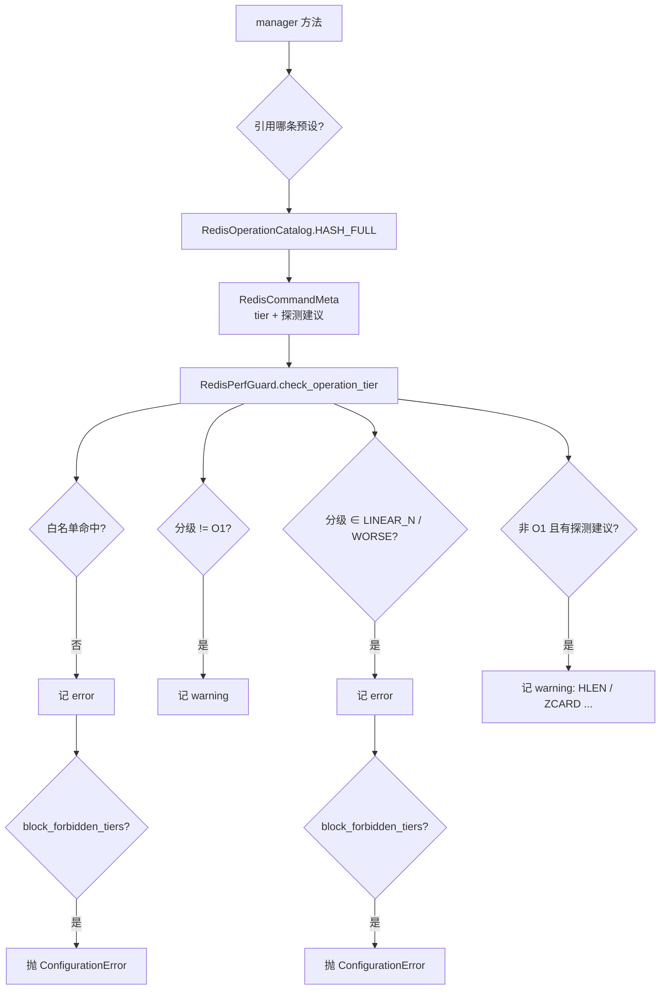
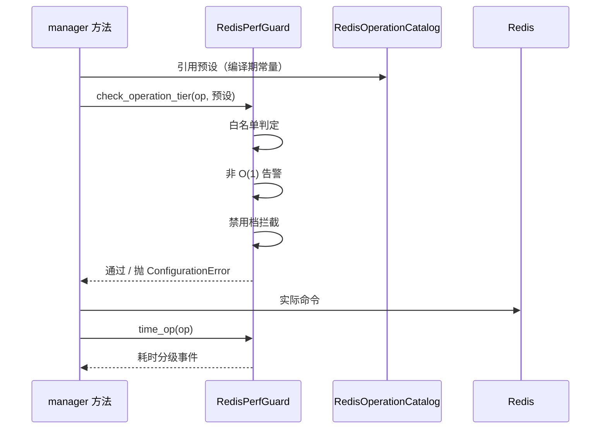

# atlas-richie-cache-redis

`atlas-richie-cache-core` 的 Redis 后端。基于 `redis-py` 实现 `ProviderRegistrar`
SPI 的全部 30 个方法（16 ops + 1 infrastructure + 11 functions + 2 meta），
对位 Java 参考实现的 `redis/manage/*` 1:1。

## 📖 目录

- [🎯 组件概览](#-组件概览)
    - [核心特性](#核心特性)
- [🏗️ 架构设计](#️-架构设计)
    - [包结构](#包结构)
    - [性能守卫的分级判定](#性能守卫的分级判定)
- [🚀 快速开始](#-快速开始)
    - [1. 声明依赖](#1-声明依赖)
    - [2. 接入后端](#2-接入后端)
    - [3. 打开性能守卫](#3-打开性能守卫)
- [📚 接口参考](#-接口参考)
    - [ProviderRegistrar 暴露面](#providerregistrar-暴露面)
- [🔧 性能守卫](#-性能守卫)
    - [复杂度分级表](#复杂度分级表)
    - [分级策略判定](#分级策略判定)
    - [String 载荷形状规则](#string-载荷形状规则)
    - [其余检查项](#其余检查项)
- [⚙️ 配置参考](#️-配置参考)
    - [RedisPerfSettings 字段](#redisperfsettings-字段)
    - [防雪崩 jitter](#防雪崩-jitter)
- [🔧 故障排查](#-故障排查)
- [📎 ⏱️ 时序图参考](#-️-时序图参考)
    - [分级判定与调用](#分级判定与调用)
- [🧪 运行集成测试](#-运行集成测试)

## 🎯 组件概览

### 核心特性

- ✅ **SPI 全实现**：16 ops + 1 infrastructure + 11 functions + 2 meta，
  零 `NotImplementedError` 桩
- ✅ **复杂度分级表**：`RedisOperationCatalog` 26 条预设，把"这条命令是
  O(n)"这件事收敛成唯一真源——manager 不再手写复杂度字符串
- ✅ **BIGKEY 探测建议**：每条预设自带该探哪个命令（`HLEN` / `ZCARD` /
  `SCARD` / `LLEN` / `STRLEN`），非 O(1) 调用自动提示
- ✅ **String 载荷形状规则**：集合 / Map 整包塞 String 会被判 ERROR——
  这类用法易 BIGKEY、阻塞序列化、难部分更新
- ✅ **零开销默认**：`enabled=false` 时所有检查都是空操作
- ✅ **防雪崩 jitter**：所有缓存条目 TTL 叠加 1–10 分钟离散随机偏移

## 🏗️ 架构设计

### 包结构

```
atlas_richie/cache_redis/
├── __init__.py                          # public API
├── errors.py                            # CacheError + 子类
├── serialization.py                     # JSON + bytes helpers
├── redis_distributed_cache.py           # redis-py wrapper
├── redis_cache_infrastructure.py        # CacheInfrastructure impl
├── redis_cache_properties.py            # RedisCacheProperties + RedisPerfSettings
├── redis_provider_registrar.py          # ProviderRegistrar impl（30/30）
├── perf/                                # 性能守卫（对位 Java redis/perf 包）
│   ├── __init__.py
│   ├── complexity_tier.py               # RedisComplexityTier
│   ├── command_meta.py                  # RedisCommandMeta（分级 + 探测建议）
│   ├── operation_catalog.py             # RedisOperationCatalog（26 条预设）
│   ├── string_payload_inspector.py      # RedisStringPayloadInspector
│   └── guard.py                         # RedisPerfGuard
└── managers/                            # 16 个 manager
```

### 性能守卫的分级判定



判定顺序与 Java `RedisPerfGuard.executeInternal` 一致。Python 侧把策略判定与
计时拆开——判定是 `check_operation_tier`（调用前置），计时仍由既有的
`time_op` context manager 承担。

## 🚀 快速开始

### 1. 声明依赖

```toml
[dependencies]
atlas-richie-cache-redis = "*"
```

### 2. 接入后端

```python
from atlas_richie.cache_redis import RedisProviderRegistrar
from atlas_richie.cache_core import CacheRegistry, GlobalCacheManager

registrar = RedisProviderRegistrar(
    redis_url="redis://127.0.0.1:16379/0",
    namespace="atlas-richie",
)
CacheRegistry.register(GlobalCacheManager(registrar))

GlobalCache.value_ops().set("user:42", {"name": "richie"})
value = GlobalCache.value_ops().get("user:42", dict)
```

### 3. 打开性能守卫

```bash
export ATLAS_RICHIE_CACHE_REDIS_PERF_ENABLED=true
export ATLAS_RICHIE_CACHE_REDIS_PERF_BLOCK_FORBIDDEN_TIERS=true
export ATLAS_RICHIE_CACHE_REDIS_PERF_TOC_ALLOWED_COMPLEXITIES='["O1","LOG_N"]'
```

关闭时（默认）所有检查都是空操作，对现有部署零影响。

## 📚 接口参考

### ProviderRegistrar 暴露面

| 类别 | 方法 |
|------|------|
| ops | `value_ops` / `struct_ops` / `field_ops` / `collection_ops` / `ranking_ops` / `key_ops` / `bitmap_ops` / `hyper_log_ops` / `geo_ops` / `script_ops` / `limiter_ops` / `bounded_queue_ops` / `bounded_stack_ops` / `lock_ops` / `notification_ops` / `event_ops` |
| infrastructure | `cache_infrastructure` |
| function | `string_function` / `hash_function` / `set_function` / `z_set_function` / `geo_function` / `hyper_log_function` / `bitmap_function` / `lock_function` / `notification_function` / `event_function` / `cache_function` |
| meta | `namespace` / `connection_string` |

## 🔧 性能守卫

### 复杂度分级表

| 分级 | 含义 | ToC 核心路径 |
|------|------|--------------|
| `O1` | 常数级 | ✅ 推荐 |
| `LOG_N` | 对数级（有序结构） | ✅ 可控范围内可用 |
| `LINEAR_N` | 线性级（与元素数 / 扫描范围相关） | ❌ 默认禁用 |
| `WORSE` | 更差（O(n log n) / O(n²) / 指数级） | ❌ 严禁 |
| `SCRIPT_OR_UNKNOWN` | 由脚本内容决定（Lua） | ⚠️ 无法静态判定 |

每条 `RedisOperationCatalog` 预设 = 一个分级 + 一组 BIGKEY 探测建议 + 一句说明：

| 预设 | 分级 | 探测建议 | 对应操作 |
|------|------|----------|----------|
| `STRING_SINGLE` | `O1` | — | GET / SET 单 key |
| `STRING_MULTI_GET` | `LINEAR_N` | — | MGET 多 key |
| `HASH_FIELD` | `O1` | — | HGET 单 field |
| `HASH_FULL` | `LINEAR_N` | `HLEN` | HGETALL / 全量 entries |
| `HASH_KEYS` | `LINEAR_N` | `HLEN` | HKEYS |
| `HASH_MULTI_FIELD` | `LINEAR_N` | — | HMGET 多 field |
| `LIST_RANGE` | `LINEAR_N` | `LLEN` | LRANGE / LINDEX |
| `KEYS_PATTERN` | `LINEAR_N` | — | KEYS 模式匹配 |
| `ZSET_ORDERED` | `LOG_N` | `ZCARD` | ZRANK / ZRANGE |
| `ZSET_MULTI_KEY` | `LINEAR_N` | `ZCARD` | ZINTER / ZUNION / ZDIFF |
| `ZSET_BATCH` | `LINEAR_N` | `ZCARD` | pipeline 批量 ZSet |
| `SET_MEMBERS` | `LINEAR_N` | `SCARD` | SMEMBERS 全量 |
| `SET_COMBINE` | `LINEAR_N` | `SCARD` | 集合交并差 |
| `GEO_RADIUS` | `LINEAR_N` | — | GEO 半径查询 |
| `GEO_ADD` / `GEO_DIST` | `O1` | — | GEOADD / GEODIST |
| `LUA_EVAL` / `LIMITER_LUA` | `SCRIPT_OR_UNKNOWN` | — | EVAL / 限流 Lua |
| `BIT_OP` | `O1` | — | SETBIT / GETBIT |
| `HLL_PFADD` | `LINEAR_N` | — | PFADD |
| `HLL_PF_COUNT` | `O1` | — | PFCOUNT |
| `EVENT_SUBSCRIBE` | `O1` | — | 订阅注册 |
| `PUBLISH` | `O1` | — | PUBLISH 广播 |
| `LOCK_TRY` | `O1` | — | SET NX/EX 加锁尝试 |
| `STREAM_XADD` / `STREAM_ACK` | `SCRIPT_OR_UNKNOWN` / `O1` | — | Stream 写入 / 确认 |

### 分级策略判定

三级判定，顺序与 Java 一致：

1. **白名单**：`toc_allowed_complexities` 非空时，分级不在名单内即记 error；
   `block_forbidden_tiers` 为真时**抛异常**拦截
2. **非 O(1) 告警**：`warn_non_o1` 为真且分级不是 `O1` 时记 warning
3. **禁用档拦截**：`block_forbidden_tiers` 为真且分级属于 `LINEAR_N` /
   `WORSE` 时**抛异常**——这两档在 ToC 核心路径必须禁用

非 O(1) 调用还会附带 **BIGKEY 探测提示**（`log_big_key_probe_hints` 开关控制）：
分级只说"这条命令是 O(n)"，探测建议才说"读之前先探一下 HLEN"。

### String 载荷形状规则

向 Redis String 写入前，检查**序列化之前**的原始值：

| 载荷形状 | 判定 | 说明 |
|----------|------|------|
| 集合 / Map（list / tuple / set / dict） | **ERROR** | 不应整包序列化进 String，应改用 Hash / List / ZSet 或拆 key |
| 非标量复杂对象（dataclass 等） | WARN | 会被序列化器打成单一大 value |
| `bytes` 超阈值 | WARN / ERROR | 易 BIGKEY / 网络放大 |
| 文本超字符阈值 | WARN / ERROR | 易形成 BIGKEY |
| 以 `{` / `[` 开头且够长 | WARN | 疑似整包 JSON |
| 标量（数字 / 布尔 / 字符串 / UUID / 时间） | OK | — |

> **关键点**：Java 的 `guardStringPayload` 拿到的是 `Object value`——原始对象，
> 所以 `instanceof Collection` 直接成立。Python 侧若沿用"先 `encode_value`
> 再检查"的顺序，集合已经被压成 JSON 字符串，形状就丢了。因此检查点前移到
> `encode_value` **之前**，用**原始值**判定。

ERROR 级别在 `block_string_payload_violations` 为真时**抛异常**——这就是
"拒绝整集合塞 String"的落点；否则只记 error 日志放行。

### 其余检查项

| 检查 | 方法 | 触发 |
|------|------|------|
| String 体积 | `check_string_payload` | 字节阈值 |
| Hash field / 整体体积 | `check_hash_field_payload` / `check_hash_payload` | 字节阈值 |
| 批量大小 | `check_batch_size` | `max_batch_read_items` |
| 耗时分级 | `time_op` | soft / hard 阈值 |
| 大 key 提示 | `check_key_name_hint` | 键名含 `all` / `dump` / `bulk` 等 token |

## ⚙️ 配置参考

### RedisPerfSettings 字段

23 个字段，1:1 对位 Java `RedisPerf`，环境变量前缀
`ATLAS_RICHIE_CACHE_REDIS_PERF_`：

| 字段 | 默认值 | 说明 |
|------|--------|------|
| `enabled` | `False` | 总开关，关闭时全部检查为空操作 |
| `warn_non_o1` | `True` | 非 O(1) 调用告警 |
| `toc_soft_ms` / `toc_hard_ms` | `8` / `50` | 耗时分级阈值 |
| `block_forbidden_tiers` | `False` | 拦截 LINEAR_N / WORSE 与白名单外分级 |
| `log_big_key_probe_hints` | `True` | 非 O(1) 调用附带探测建议 |
| `toc_allowed_complexities` | `[]` | 分级白名单，空 = 不判定 |
| `warn_string_payload_anti_patterns` | `True` | String 载荷形状检查 |
| `json_like_min_chars_for_warn` | `128` | 疑似整包 JSON 的字符阈值 |
| `warn_json_like_string_blob` | `True` | 疑似整包 JSON 启发式开关 |
| `string_payload_max_chars_{warn,error}` | `100_000` / `1_000_000` | String 字符阈值 |
| `string_payload_max_bytes_{warn,error}` | `262_144` / `1_048_576` | String 字节阈值 |
| `block_string_payload_violations` | `False` | String 载荷 ERROR 时抛异常 |
| `max_batch_read_items` / `block_batch_read_violations` | `1_000` / `True` | 批量大小 |
| `warn_hash_payload_violations` + Hash 三组阈值 | — | Hash 载荷体积 |

### 防雪崩 jitter

本驱动写入的每条缓存条目 TTL 都在调用方 TTL 之上叠加 1–10 个整分钟的随机偏移，
让一批同时写入的 key 不会在同一瞬间过期。

| 路径 | 抖动 | Java 对位 |
|---|---|---|
| `StringFunction.add_value` / `add_value_if_absent` / `batch_add_to_string_with_ttl` / `batch_update_if_absent` | 有 | `RedisStringManager`——同样的四个调用点 |
| `*_with_lock` 回写（String / Set / Hash） | 有 | Java 经 `addValue` / `expire(key, timeout + jitter)` 发布 |
| `CollectionOps.set(key, values, timeout_millis)` | 有 | `RedisSetManager` |
| `HashFunction.set(...)` / `set_all(...)` | 有 | `RedisHashManager.addObject` |
| `KeyOps.set_expired_time(key, timeout)` | 有 | `RedisKeyManager.setExpiredTime` |
| `ValueOps.set_with_ttl` / `set_if_absent_with_ttl` / `batch_set_with_ttl` | **无** | 底层原始 op——TTL 由调用方负责 |
| M5.7 负缓存标记 | **无** | 短抑制窗口，不是缓存条目 |

偏移量来自 `atlas-richie-cache-core` 的 `CacheFunction.get_random_extra_millis()`
——全平台唯一实现。后端不得自带副本：分布本身是契约的一部分（离散整分钟档，
对位 Java 的 `ThreadLocalRandom.current().nextInt(1, 11) * 60_000L`）。

## 🔧 故障排查

| 现象 | 可能原因 | 处理 |
|------|----------|------|
| 分级检查没反应 | `enabled=false` | 打开总开关；关闭时所有检查都是空操作 |
| 抛 `ConfigurationError` 说 tier 不在白名单 | `toc_allowed_complexities` 没覆盖该分级 | 把分级名加进白名单（大小写不敏感） |
| O(1) 操作也被拦 | `block_forbidden_tiers` 只拦 LINEAR_N / WORSE | 确认该操作引用的预设是否正确 |
| String 写入被拒 | 载荷是集合 / Map | 改用 Hash / List / ZSet 结构，或拆 key |
| 长 key 刷屏日志 | 日志里的 key 被截断到 160 字符 | 正常行为，日志已做截断保护 |

## 📎 ⏱️ 时序图参考

### 分级判定与调用



## 🧪 运行集成测试

凭证从不停留在代码里。测试默认用无密码的 `redis://127.0.0.1:16379/0`，
当该服务不可达**或**需要密码而测试没有时，干净地 skip（门禁是 PING，不是
只探 TCP）。

用环境变量指向你自己的实例：

```bash
export ATLAS_RICHIE_CACHE_REDIS_URL='redis://:YOUR_PASSWORD@127.0.0.1:16379/1'
uv run python -m pytest components/cache -q
```

同样的模式适用于 `ATLAS_RICHIE_STREAMMQ_REDIS_URL`、
`ATLAS_RICHIE_STATEMACHINE_REDIS_URL`、`ATLAS_RICHIE_COORDINATION_REDIS_URL`
与 `ATLAS_RICHIE_SECRET_REDIS_TEST_URL`。
