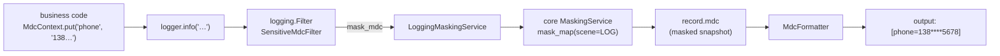
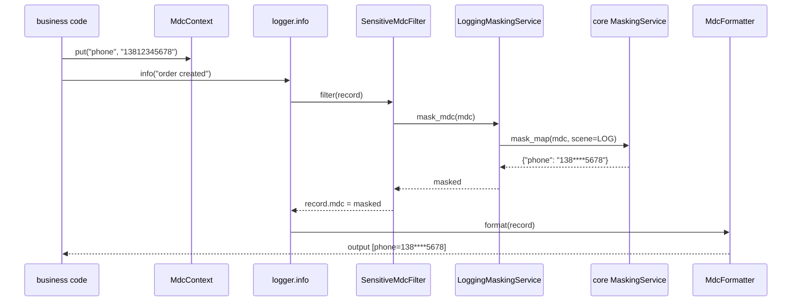

# atlas-richie-desensitize-logging

Logging-side desensitization: the **MDC context**, the **interception point**
that masks it, and the **logging masking SPI**.

**Zero runtime dependencies** beyond the standard library and
atlas-richie-desensitize-core. Which value looks masked is decided by the core
package; this package only adapts those rules to the Python logging stack.

[English](./README.md) | [简体中文](./README.zh.md)

## 📖 Table of Contents

- [🎯 Component Overview](#-component-overview)
  - [Key Features](#key-features)
- [🏗️ Architecture Design](#-architecture-design)
  - [Where the Masking Happens](#where-the-masking-happens)
  - [Java → Python Mapping](#java--python-mapping)
- [🚀 Quick Start](#-quick-start)
- [📚 Interface Reference](#-interface-reference)
  - [`MdcContext`](#mdccontext)
  - [`LoggingMaskingService`](#loggingmaskingservice)
  - [`SensitiveMdcFilter`](#sensitivemdcfilter)
  - [`SensitiveLogArgFilter`](#sensitivelogargfilter)
  - [`MdcFormatter`](#mdcformatter)
- [🔧 Core Capabilities](#-core-capabilities)
  - [Scenario 1: Mask MDC fields by key](#scenario-1-mask-mdc-fields-by-key)
  - [Scenario 2: Keep credentials out of log arguments](#scenario-2-keep-credentials-out-of-log-arguments)
  - [Scenario 3: Render MDC into structured logs](#scenario-3-render-mdc-into-structured-logs)
- [⚙️ Differences from the Java Baseline](#-differences-from-the-java-baseline)
- [🔧 Troubleshooting](#-troubleshooting)
- [📎 ⏱️ Sequence Diagrams](#-sequence-diagrams)
  - [Masking an MDC Field](#masking-an-mdc-field)

## 🎯 Component Overview

Ported from the Java `atlas-richie-desensitize-logging` module. The Java side
is built on Logback: a `TurboFilter` rewrites the MDC **before** the logging
event is created, so the JSON layout's `includeMdc` prints masked values.

Python has no Logback and no MDC, so this port provides both equivalents:

- **MDC** → a `contextvars`-backed context (`MdcContext`)
- **TurboFilter** → a stdlib `logging.Filter`, which runs after the record is
  created and **before** `Formatter.format()` — the same window

### Key Features

- ✅ **MDC context**: thread-safe *and* task-safe — `contextvars` covers asyncio
  tasks, which share a thread
- ✅ **Key-driven masking**: MDC fields are masked by the same sensitive-key
  rules the JSON log payload uses
- ✅ **Never breaks the log chain**: every failure falls back to the original
  value; desensitization is a side channel, losing a log line is worse than
  leaking one field
- ✅ **Two interception points**: context fields (`SensitiveMdcFilter`) and log
  arguments (`SensitiveLogArgFilter`)
- ✅ **No global state**: the masking service is injected; the Java side binds a
  static global that throws when it is not initialised
- ✅ **Zero runtime dependencies**: standard library + desensitize-core only

## 🏗️ Architecture Design

### Where the Masking Happens



The filter never edits the context by default — it attaches the masked snapshot
to the record, and the formatter renders that snapshot. The Java side writes the
masked value back into the MDC instead; see the differences table.

### Java → Python Mapping

| Java | Python | Note |
| --- | --- | --- |
| `LoggingMaskingService` | `LoggingMaskingService` (Protocol) | same two methods |
| `DefaultLoggingMaskingService` | `DefaultLoggingMaskingService` | masking service injected, not a static global |
| `SensitiveMdcTurboFilter` | `SensitiveMdcFilter` | Logback turbo filter → stdlib filter |
| `SensitiveLogArgTurboFilter` | `SensitiveLogArgFilter` | replaces the arguments in place |
| `DesensitizeConverter` (`%desensitizeMsg`) | `MdcFormatter` / `to_masked_message()` | conversion rule → formatter subclass |
| `org.slf4j.MDC` | `MdcContext` | ThreadLocal → contextvars |
| `LoggingDesensitizeAutoConfiguration` | — | no Spring: you install the filter |

## 🚀 Quick Start

```python
import logging

from atlas_richie.desensitize_core import (
    DefaultMaskingService, DesensitizeProperties, MaskType,
)
from atlas_richie.desensitize_logging import (
    DefaultLoggingMaskingService, MdcContext, MdcFormatter, SensitiveMdcFilter,
)

properties = DesensitizeProperties(
    sensitive_keys={"phone": MaskType.PHONE, "email": MaskType.EMAIL},
)
service = DefaultLoggingMaskingService(DefaultMaskingService(properties))

handler = logging.StreamHandler()
handler.addFilter(SensitiveMdcFilter(service))
handler.setFormatter(MdcFormatter("%(asctime)s %(levelname)s %(message)s"))

logger = logging.getLogger("app")
logger.addHandler(handler)
logger.setLevel(logging.INFO)

MdcContext.put("phone", "13812345678")
logger.info("order created")
# 2026-11-20 11:20:00,123 INFO order created [phone=138****5678]
```

**Only the keys you list are masked.** `sensitive_keys` is empty by default, so
an MDC field that is not listed is printed verbatim. Configure the keys you
actually put into the context — that list is the whole contract.

## 📚 Interface Reference

### `MdcContext`

The MDC context — a `contextvars.ContextVar` holding a mapping.

| Method | Meaning |
| --- | --- |
| `current()` | snapshot of the current context (a copy) |
| `get(key)` | one value, or None |
| `put(key, value)` | write one key |
| `remove(key)` | drop one key |
| `clear()` | drop everything |
| `scope(**pairs)` | context manager: add keys, restore on exit |

```python
from atlas_richie.desensitize_logging import MdcContext

MdcContext.put("traceId", "abc123")
with MdcContext.scope(userId="u-1"):
    ...          # traceId + userId are visible here
# userId is gone again, traceId survives
```

Every write replaces the mapping instead of mutating it: the ContextVar default
is a **shared** object, so mutating it in place would leak values across
requests.

### `LoggingMaskingService`

The SPI — what the Java side calls `LoggingMaskingService`.

| Method | Meaning |
| --- | --- |
| `mask_mdc(mdc)` | mask the context fields; None in → None out, empty in → empty out |
| `to_masked_message(record)` | render the record with masked arguments |

```python
service = DefaultLoggingMaskingService(DefaultMaskingService(properties))
masked = service.mask_mdc({"phone": "13812345678"})
# {"phone": "138****5678"}
```

### `SensitiveMdcFilter`

Masks the context fields before the record is formatted.

| Parameter | Default | Meaning |
| --- | --- | --- |
| `service` | `DefaultLoggingMaskingService()` | the masking SPI to use |
| `name` | "" | stdlib filter name, for selective installation |
| `in_place` | False | write the masked values back into the context (the Java behaviour) |

Install it on the **handler** so every record reaching that handler is masked:

```python
handler.addFilter(SensitiveMdcFilter(service))
```

The masked snapshot lands on `record.mdc`; `record.mdc_masked` says whether
masking actually changed anything.

### `SensitiveLogArgFilter`

Replaces `SensitiveLogArg` arguments with their masked string, in place.

| Parameter | Default | Meaning |
| --- | --- | --- |
| `name` | "" | stdlib filter name |

```python
handler.addFilter(SensitiveLogArgFilter())
```

Python's `SensitiveLogArg.__str__` already masks, so this filter is a second
line of defence. Its real value: after it runs, `record.args` no longer holds
the sensitive object — a custom formatter that reads `arg.raw_value` would
otherwise leak it.

### `MdcFormatter`

Appends the MDC to the formatted line — the equivalent of Logback's
`includeMdc`.

| Parameter | Default | Meaning |
| --- | --- | --- |
| `fmt` | None | the stdlib format string |
| `datefmt` | None | the date format string |
| `style` | "%" | "%", "{" or "$" |
| `mdc_separator` | " " | between the message and the MDC block |
| `mdc_template` | "[{key}={value}]" | per-field rendering |

## 🔧 Core Capabilities

### Scenario 1: Mask MDC fields by key

The context carries request-scoped facts; the log line must not carry the
sensitive ones.

```python
properties = DesensitizeProperties(
    log=SceneOverride(sensitive_keys={"idCard": MaskType.ID_CARD}),
)
service = DefaultLoggingMaskingService(DefaultMaskingService(properties))
handler.addFilter(SensitiveMdcFilter(service))
handler.setFormatter(MdcFormatter("%(message)s"))

MdcContext.put("idCard", "110101199003071234")
MdcContext.put("orderId", "ORD-2026-0001")
logger.info("order paid")
# order paid [idCard=110101********1234] [orderId=ORD-2026-0001]
```

**Scope**: only the listed keys are masked; the rest pass through. **Cost**: the
filter runs once per log record and walks the whole context, so keep the context
small — a handful of keys, not a payload dump. Dumping a request body into the
MDC would both slow the log path and widen the leak surface.

### Scenario 2: Keep credentials out of log arguments

```python
from atlas_richie.desensitize_core import SensitiveLogArg

logger.info("login user=%s token=%s", "u-1", SensitiveLogArg.api_key("sk-9f8e7d"))
# login user=u-1 token=sk-9*********
```

With `SensitiveLogArgFilter` installed, `record.args` holds the masked string
rather than the object.

### Scenario 3: Render MDC into structured logs

A JSON formatter that includes the context:

```python
import json
from atlas_richie.desensitize_logging import mdc_of


class JsonFormatter(logging.Formatter):
    def format(self, record):
        return json.dumps(
            {"level": record.levelname, "msg": record.getMessage(), "mdc": mdc_of(record)},
            ensure_ascii=False,
        )


handler.setFormatter(JsonFormatter())
handler.addFilter(SensitiveMdcFilter(service))
```

`mdc_of(record)` returns the masked snapshot when a filter produced one, and
the raw context otherwise — so install the filter **before** the formatter reads
it.

## ⚙️ Differences from the Java Baseline

| Topic | Java | Python | Why |
| --- | --- | --- | --- |
| MDC storage | `ThreadLocal` | `contextvars.ContextVar` | asyncio tasks share one thread; a ThreadLocal would leak values between them |
| MDC write-back | the masked value is written back into the MDC and never restored | the context is left untouched; the masked snapshot goes onto `record.mdc` (`in_place=True` reproduces the Java behaviour) | writing back silently corrupts the business context — the code reading `MdcContext.get("phone")` would get the masked value |
| Interception point | Logback `TurboFilter` | stdlib `logging.Filter` | Python has no Logback; the filter runs before `Formatter.format()`, the same window |
| Masking service binding | static `DesensitizeUtils` global, throws `IllegalStateException` when not initialised | the masking service is injected; there is no "uninitialised" state | the Python core has no global runtime |
| `maskMdc` failure handling | catches `IllegalStateException` only | catches every exception | the Python side has no specific "uninitialised" failure, and desensitization must never break the log chain |
| `toMaskedMessage` input | `ILoggingEvent` | `logging.LogRecord` | the Python record carries the same template and arguments |
| MDC rendering | Logback `includeMdc` | `MdcFormatter` | Logback has no Python equivalent |
| Auto configuration | `LoggingDesensitizeAutoConfiguration` registers the filters | none — you install them | no Spring on the Python side |

## 🔧 Troubleshooting

| Symptom | Cause | Fix |
| --- | --- | --- |
| The log still shows the raw phone number | no sensitive key is configured | add `sensitive_keys={"phone": MaskType.PHONE}` — the list is empty by default |
| The MDC never shows up in the log | the formatter does not read the context | use `MdcFormatter`, or read `mdc_of(record)` in a custom formatter |
| The MDC shows up but is not masked | `SensitiveMdcFilter` is not installed | install it on the handler, before the formatter reads the record |
| The business code reads a masked value | `in_place=True` was used | drop the flag — the default mode leaves the context untouched |
| MDC values leak between asyncio tasks | the context was set before the tasks were created | `contextvars` copies the context into each task; set the values inside the task, or use `MdcContext.scope` |
| A masking failure is visible in the log | it should not be — failures fall back to the original value | the fallback is deliberate; check the injected service instead |

## 📎 ⏱️ Sequence Diagrams

### Masking an MDC Field


