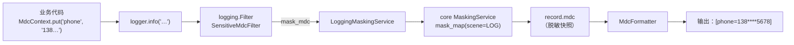
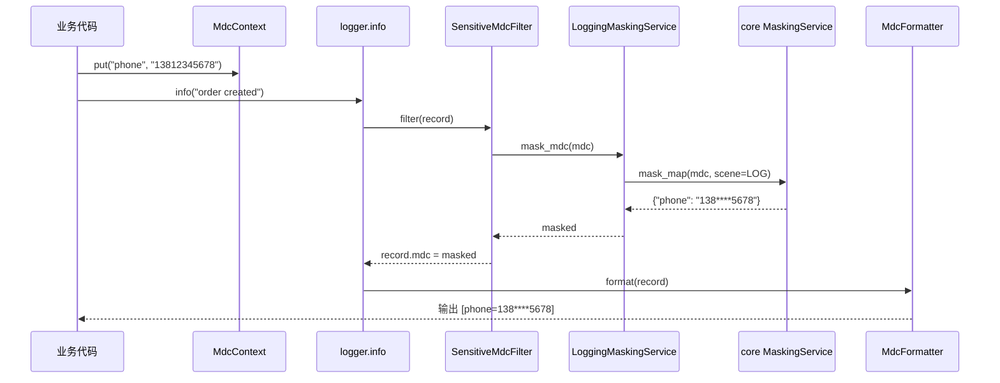

# atlas-richie-desensitize-logging

日志侧脱敏：**MDC 上下文**、把它脱敏的**拦截点**，以及**日志脱敏 SPI**。

除标准库与 atlas-richie-desensitize-core 外**零运行时依赖**。「哪个值该长什么样」
由 core 包决定；本包只负责把这些规则接到 Python 的日志栈上。

[English](./README.md) | [简体中文](./README.zh.md)

## 📖 目录

- [🎯 组件概览](#-组件概览)
  - [核心能力](#核心能力)
- [🏗️ 架构设计](#-架构设计)
  - [脱敏发生在哪里](#脱敏发生在哪里)
  - [Java → Python 对位](#java--python-对位)
- [🚀 快速开始](#-快速开始)
- [📚 接口参考](#-接口参考)
  - [`MdcContext`](#mdccontext)
  - [`LoggingMaskingService`](#loggingmaskingservice)
  - [`SensitiveMdcFilter`](#sensitivemdcfilter)
  - [`SensitiveLogArgFilter`](#sensitivelogargfilter)
  - [`MdcFormatter`](#mdcformatter)
- [🔧 核心场景](#-核心场景)
  - [场景 1：按 key 脱敏 MDC 字段](#场景-1按-key-脱敏-mdc-字段)
  - [场景 2：让凭证别进日志参数](#场景-2让凭证别进日志参数)
  - [场景 3：把 MDC 渲染进结构化日志](#场景-3把-mdc-渲染进结构化日志)
- [⚙️ 与 Java 基准的差异](#-与-java-基准的差异)
- [🔧 排障](#-排障)
- [📎 ⏱️ 时序图](#-时序图)
  - [一个 MDC 字段的脱敏过程](#一个-mdc-字段的脱敏过程)

## 🎯 组件概览

移植自 Java 的 `atlas-richie-desensitize-logging` 模块。Java 侧基于 Logback：
一个 `TurboFilter` 在**日志事件创建前**改写 MDC，于是 JSON layout 的
`includeMdc` 打印出来的就是脱敏值。

Python 既没有 Logback 也没有 MDC，所以本移植把两者的等价物都补上：

- **MDC** → `contextvars` 支撑的上下文（`MdcContext`）
- **TurboFilter** → 标准库的 `logging.Filter`，它在 record 创建**之后**、
  `Formatter.format()` **之前**运行 —— 正是同一个窗口

### 核心能力

- ✅ **MDC 上下文**：线程安全**且**任务安全 —— `contextvars` 覆盖 asyncio
  任务（它们共用一个线程）
- ✅ **按 key 脱敏**：MDC 字段走与 JSON 日志同一套敏感键规则
- ✅ **绝不打断日志链路**：任何失败都回退原值 —— 脱敏是旁路，丢一条日志比漏
  一个字段更糟
- ✅ **两个拦截点**：上下文字段（`SensitiveMdcFilter`）与日志参数
  （`SensitiveLogArgFilter`）
- ✅ **无全局状态**：脱敏服务由调用方注入；Java 侧绑的是静态全局，未初始化就抛
- ✅ **零运行时依赖**：只用标准库 + desensitize-core

## 🏗️ 架构设计

### 脱敏发生在哪里



过滤器**默认不改上下文** —— 它把脱敏快照挂到 record 上，由 formatter 渲染这个
快照。Java 侧是把脱敏值写回 MDC，差异见后表。

### Java → Python 对位

| Java | Python | 说明 |
| --- | --- | --- |
| `LoggingMaskingService` | `LoggingMaskingService`（Protocol） | 同样两个方法 |
| `DefaultLoggingMaskingService` | `DefaultLoggingMaskingService` | 注入脱敏服务，不绑静态全局 |
| `SensitiveMdcTurboFilter` | `SensitiveMdcFilter` | Logback turbo filter → 标准库 filter |
| `SensitiveLogArgTurboFilter` | `SensitiveLogArgFilter` | 就地替换参数 |
| `DesensitizeConverter`（`%desensitizeMsg`） | `MdcFormatter` / `to_masked_message()` | conversion rule → formatter 子类 |
| `org.slf4j.MDC` | `MdcContext` | ThreadLocal → contextvars |
| `LoggingDesensitizeAutoConfiguration` | —— | 没有 Spring：过滤器由你自己装 |

## 🚀 快速开始

```python
import logging

from atlas_richie.desensitize_core import (
    DefaultMaskingService, DesensitizeProperties, MaskType,
)
from atlas_richie.desensitize_logging import (
    DefaultLoggingMaskingService, MdcContext, MdcFormatter, SensitiveMdcFilter,
)

properties = DesensitizeProperties(
    sensitive_keys={"phone": MaskType.PHONE, "email": MaskType.EMAIL},
)
service = DefaultLoggingMaskingService(DefaultMaskingService(properties))

handler = logging.StreamHandler()
handler.addFilter(SensitiveMdcFilter(service))
handler.setFormatter(MdcFormatter("%(asctime)s %(levelname)s %(message)s"))

logger = logging.getLogger("app")
logger.addHandler(handler)
logger.setLevel(logging.INFO)

MdcContext.put("phone", "13812345678")
logger.info("order created")
# 2026-11-20 11:20:00,123 INFO order created [phone=138****5678]
```

**只有你列出来的 key 才会被脱敏。** `sensitive_keys` 默认是空的，没列进去的 MDC
字段会原样打印。把你真正放进上下文的 key 配出来 —— 这份清单就是全部契约。

## 📚 接口参考

### `MdcContext`

MDC 上下文 —— 一个装着 mapping 的 `contextvars.ContextVar`。

| 方法 | 含义 |
| --- | --- |
| `current()` | 当前上下文的快照（拷贝） |
| `get(key)` | 取一个值，没有则 None |
| `put(key, value)` | 写一个键 |
| `remove(key)` | 删一个键 |
| `clear()` | 全清 |
| `scope(**pairs)` | 上下文管理器：进入时加键，退出时恢复 |

```python
from atlas_richie.desensitize_logging import MdcContext

MdcContext.put("traceId", "abc123")
with MdcContext.scope(userId="u-1"):
    ...          # 这里 traceId + userId 都可见
# userId 没了，traceId 还在
```

每次写入都是**换一个新 mapping**，不是原地改：ContextVar 的默认值是**共享对象**，
原地改会跨请求串味。

### `LoggingMaskingService`

SPI —— Java 侧叫 `LoggingMaskingService`。

| 方法 | 含义 |
| --- | --- |
| `mask_mdc(mdc)` | 脱敏上下文字段；入参 None 返回 None，空 map 返回空 map |
| `to_masked_message(record)` | 用脱敏后的参数渲染记录 |

```python
service = DefaultLoggingMaskingService(DefaultMaskingService(properties))
masked = service.mask_mdc({"phone": "13812345678"})
# {"phone": "138****5678"}
```

### `SensitiveMdcFilter`

在记录被格式化之前把上下文字段脱敏。

| 参数 | 默认 | 含义 |
| --- | --- | --- |
| `service` | `DefaultLoggingMaskingService()` | 使用的脱敏 SPI |
| `name` | "" | 标准库 filter 名，便于选择性安装 |
| `in_place` | False | 把脱敏值写回上下文（Java 的行为） |

装在 **handler** 上，这样到达该 handler 的每条记录都会被脱敏：

```python
handler.addFilter(SensitiveMdcFilter(service))
```

脱敏快照落在 `record.mdc` 上；`record.mdc_masked` 表示是否真的改动了内容。

### `SensitiveLogArgFilter`

把参数里的 `SensitiveLogArg` 就地换成脱敏字符串。

| 参数 | 默认 | 含义 |
| --- | --- | --- |
| `name` | "" | 标准库 filter 名 |

```python
handler.addFilter(SensitiveLogArgFilter())
```

Python 的 `SensitiveLogArg.__str__` 本身就会脱敏，所以这个过滤器是双保险。
它真正的价值：跑完之后 `record.args` 里**不再持有敏感对象** —— 否则自定义
formatter 去读 `arg.raw_value` 就漏了。

### `MdcFormatter`

把 MDC 追加到格式化结果末尾 —— 等价于 Logback 的 `includeMdc`。

| 参数 | 默认 | 含义 |
| --- | --- | --- |
| `fmt` | None | 标准库格式串 |
| `datefmt` | None | 时间格式串 |
| `style` | "%" | "%"、"{" 或 "$" |
| `mdc_separator` | " " | 消息与 MDC 段之间的分隔 |
| `mdc_template` | "[{key}={value}]" | 单个字段的渲染方式 |

## 🔧 核心场景

### 场景 1：按 key 脱敏 MDC 字段

上下文带的是请求级事实，日志行里不能带敏感的那部分。

```python
properties = DesensitizeProperties(
    log=SceneOverride(sensitive_keys={"idCard": MaskType.ID_CARD}),
)
service = DefaultLoggingMaskingService(DefaultMaskingService(properties))
handler.addFilter(SensitiveMdcFilter(service))
handler.setFormatter(MdcFormatter("%(message)s"))

MdcContext.put("idCard", "110101199003071234")
MdcContext.put("orderId", "ORD-2026-0001")
logger.info("order paid")
# order paid [idCard=110101********1234] [orderId=ORD-2026-0001]
```

**范围**：只有列出的 key 被脱敏，其余原样通过。**代价**：过滤器每条日志跑一次、
遍历整个上下文，所以上下文要小 —— 几个 key 就够，别把请求体整个塞进 MDC：那既
拖慢日志路径，又把泄露面放大。

### 场景 2：让凭证别进日志参数

```python
from atlas_richie.desensitize_core import SensitiveLogArg

logger.info("login user=%s token=%s", "u-1", SensitiveLogArg.api_key("sk-9f8e7d"))
# login user=u-1 token=sk-9*********
```

装了 `SensitiveLogArgFilter` 后，`record.args` 里存的是脱敏字符串而不是对象。

### 场景 3：把 MDC 渲染进结构化日志

一个带上下文的 JSON formatter：

```python
import json
from atlas_richie.desensitize_logging import mdc_of


class JsonFormatter(logging.Formatter):
    def format(self, record):
        return json.dumps(
            {"level": record.levelname, "msg": record.getMessage(), "mdc": mdc_of(record)},
            ensure_ascii=False,
        )


handler.setFormatter(JsonFormatter())
handler.addFilter(SensitiveMdcFilter(service))
```

`mdc_of(record)` 在过滤器产出快照时返回**脱敏快照**，否则返回原始上下文 ——
所以要先装过滤器，formatter 才读得到脱敏值。

## ⚙️ 与 Java 基准的差异

| 主题 | Java | Python | 原因 |
| --- | --- | --- | --- |
| MDC 存储 | `ThreadLocal` | `contextvars.ContextVar` | asyncio 任务共用一个线程，ThreadLocal 会在任务之间串味 |
| MDC 写回 | 脱敏值写回 MDC 且不还原 | 默认不动上下文，脱敏快照挂到 `record.mdc`（`in_place=True` 可复刻 Java 行为） | 写回会悄悄污染业务上下文 —— 读 `MdcContext.get("phone")` 的代码会拿到脱敏值 |
| 拦截点 | Logback `TurboFilter` | 标准库 `logging.Filter` | Python 没有 Logback；filter 跑在 `Formatter.format()` 之前，窗口相同 |
| 脱敏服务绑定 | 静态 `DesensitizeUtils` 全局，未初始化抛 `IllegalStateException` | 注入脱敏服务，不存在「未初始化」状态 | Python 的 core 没有全局运行时 |
| `maskMdc` 失败处理 | 只捕获 `IllegalStateException` | 捕获任何异常 | Python 侧没有特定的「未初始化」失败，且脱敏绝不能打断日志链路 |
| `toMaskedMessage` 入参 | `ILoggingEvent` | `logging.LogRecord` | Python 的 record 带着同样的模板与参数 |
| MDC 渲染 | Logback `includeMdc` | `MdcFormatter` | Logback 没有 Python 对位物 |
| 自动装配 | `LoggingDesensitizeAutoConfiguration` 注册过滤器 | 无 —— 自己装 | Python 侧没有 Spring |

## 🔧 排障

| 现象 | 原因 | 处理 |
| --- | --- | --- |
| 日志里还是明文手机号 | 没配敏感键 | 加 `sensitive_keys={"phone": MaskType.PHONE}` —— 默认是空清单 |
| 日志里根本没有 MDC | formatter 不读上下文 | 用 `MdcFormatter`，或在自定义 formatter 里读 `mdc_of(record)` |
| MDC 出现了但没脱敏 | 没装 `SensitiveMdcFilter` | 装在 handler 上，且要在 formatter 读 record 之前生效 |
| 业务代码读到的是脱敏值 | 用了 `in_place=True` | 去掉这个开关 —— 默认模式不动上下文 |
| asyncio 任务之间 MDC 串味 | 上下文是在任务创建**前**设的 | `contextvars` 会把上下文拷进每个任务，在任务内部设值，或用 `MdcContext.scope` |
| 日志里出现脱敏失败 | 不该出现 —— 失败会回退原值 | 回退是刻意的；去查注入的服务 |

## 📎 ⏱️ 时序图

### 一个 MDC 字段的脱敏过程


