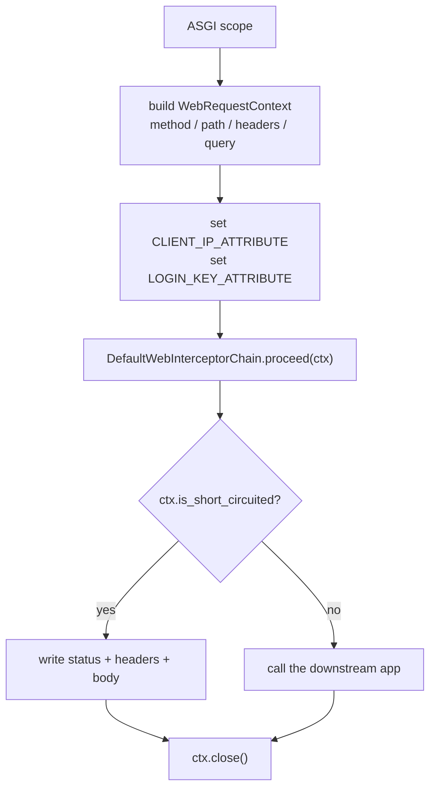
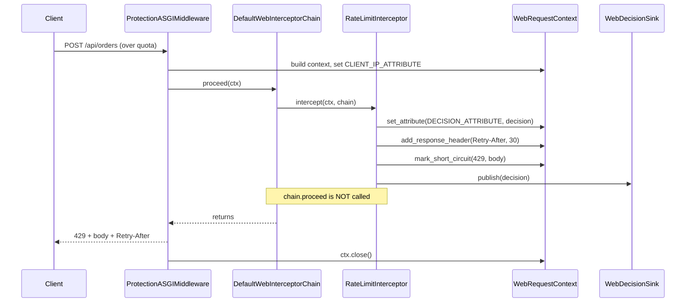

# atlas-richie-web-protection-adapter-asgi

ASGI middleware that wires the atlas-richie-web-protection guards into incoming
request handling — now through the shared **interceptor chain** and the shared
**decision event**. Pure ASGI: no Starlette, no framework dependency.

These guards are **server-side** protections, so ASGI middleware is the correct
integration point. The atlas_richie.http interceptor chain is a *client* facade
and is deliberately not used.

Depends only on atlas-richie-web-protection; the zero-dependency core is not
polluted by adapter concerns.

## 📖 Table of Contents

- [🎯 Component Overview](#-component-overview)
  - [Key Features](#key-features)
- [🏗️ Architecture Design](#-architecture-design)
  - [Request Flow](#request-flow)
  - [Chain Assembly Order](#chain-assembly-order)
- [🚀 Quick Start](#-quick-start)
- [📚 Interface Reference](#-interface-reference)
  - [Constructor Parameters](#constructor-parameters)
  - [Public Helpers](#public-helpers)
- [🔧 Core Capabilities](#-core-capabilities)
  - [Scenario 1: Observing every rejection](#scenario-1-observing-every-rejection)
  - [Scenario 2: Long-lived paths](#scenario-2-long-lived-paths)
  - [Scenario 3: Gateway bypass](#scenario-3-gateway-bypass)
  - [Scenario 4: Login attempt tracking](#scenario-4-login-attempt-tracking)
  - [Scenario 5: Distributed rate limiting](#scenario-5-distributed-rate-limiting)
  - [Scenario 6: Trace normalisation](#scenario-6-trace-normalisation)
- [⚙️ Differences from the Java Baseline](#-differences-from-the-java-baseline)
- [🔧 Troubleshooting](#-troubleshooting)
- [📎 ⏱️ Sequence Diagrams](#-sequence-diagrams)
  - [Rejected Request](#rejected-request)

## 🎯 Component Overview

The middleware is the **single** ASGI adaptation point (the Java side has
exactly one too: `InterceptingFilter`). It builds a `WebRequestContext` from the
ASGI scope, drives the interceptor chain, and — when a guard short-circuits —
writes the rejection back from the context instead of calling the app.

### Key Features

- ✅ **Chain-driven**: every guard is an interceptor; the middleware only
  assembles the chain and renders the outcome
- ✅ **One decision event**: pass `decision_sink` and every rejection is
  reported with its interceptor, key, status and reason
- ✅ **Identical rejection bytes**: status codes, bodies, headers and the
  Content-Length are unchanged from the previous inline implementation
- ✅ **Framework-neutral**: the chain can be reused from any adapter; the
  middleware holds no protection logic of its own
- ✅ **Optional guards**: with none configured the middleware is a passthrough
- ✅ **Non-http scopes**: lifespan and websocket scopes pass straight through

## 🏗️ Architecture Design

### Request Flow



### Chain Assembly Order

Cheap to expensive, so a rejected request costs as little as possible. The
order matches the previous inline implementation item by item.

| # | Interceptor | Added when | Rejection |
| --- | --- | --- | --- |
| 1 | `TraceIdInterceptor` | `enable_trace_id` is True (default) | never rejects |
| 2 | `IpBlacklistInterceptor` | `ip_blacklist` is not empty | 403 `ip_blacklisted` |
| 3 | `GatewayBypassInterceptor` | `gateway_bypass_header` is not None | never rejects |
| 4 | `LongLivedBypassInterceptor` | `long_lived_bypass` is not None | never rejects |
| 5 | `BotUserAgentInterceptor` | `bot_matchers` is not empty | 403 `bot_detected` |
| 6 | `RequestSizeInterceptor` | `size_guard` is set | 413 / 431 |
| 7 | `LoginLockInterceptor` | `login_tracker` is set | 429 `account_locked` |
| 8 | `IdempotencyInterceptor` | `idempotency_guard` is set | 409 `idempotent_replay` |
| 9 | `RateLimitInterceptor` | `rate_limit_guard` is set | 429 / 401 |
| 10 | `SignatureInterceptor` | `signature_verifier` is set | 401 + verifier reason |

The gateway identity layer is always present — it only sets attributes and
never rejects, so the chain is never empty even with no guards configured. The
trace interceptor comes **first** (Java `ORDER = 50`), so every later
interceptor can read `ctx.trace_id`.

## 🚀 Quick Start

```python
from atlas_richie.web_protection import (
    ApiSignatureVerifier, BotUserAgentMatcher, IpBlacklistEntry,
    LoginAttemptTracker, NonceCache, RequestSizeGuard,
)
from atlas_richie.web_protection_adapter_asgi import ProtectionASGIMiddleware

app = ProtectionASGIMiddleware(
    my_asgi_app,
    ip_blacklist=[IpBlacklistEntry("10.0.0.0/8")],
    bot_matchers=[BotUserAgentMatcher("*curl*")],
    size_guard=RequestSizeGuard(max_body_bytes=1_048_576, max_header_bytes=16_384),
    signature_verifier=ApiSignatureVerifier(key_provider, NonceCache(300), 60),
    login_tracker=LoginAttemptTracker(window_seconds=300, max_attempts=5, lockout_seconds=900),
)
```

Every guard is optional; with none configured the middleware is a passthrough.
Non-http scopes (including lifespan and websocket) pass straight through.

## 📚 Interface Reference

### Constructor Parameters

| Parameter | Default | Meaning |
| --- | --- | --- |
| app | — | the downstream ASGI app |
| `ip_blacklist` | () | `IpBlacklistEntry` list |
| `bot_matchers` | () | `BotUserAgentMatcher` list |
| `size_guard` | None | `RequestSizeGuard` instance |
| `signature_verifier` | None | `ApiSignatureVerifier` instance |
| `rate_limit_guard` | None | `RateLimitGuard` instance |
| `idempotency_guard` | None | `IdempotencyGuard` instance |
| `long_lived_bypass` | None | `LongLivedPathBypass` instance |
| `login_tracker` | None | `LoginAttemptTracker` instance |
| `login_paths` | (/login, /api/user/login, /oauth2/token) | paths tracked for login outcomes |
| `login_key` | client IP | callable (scope, headers) -> key or None |
| `client_key_header` | `x-client-key` | header carrying the client key |
| `trust_forwarded` | False | take the first hop of `X-Forwarded-For` as the client IP |
| `gateway_bypass_header` | `x-forwarded-from-gateway` | header proving the request came via the gateway; None disables the bypass |
| `deny_renderer` | {"error": reason} JSON | callable (status, reason) -> bytes |
| `deny_status_ip` | 403 | rejection status for the IP blacklist |
| `deny_status_bot` | 403 | rejection status for bot User-Agents |
| `deny_status_signature` | 401 | rejection status for signature failures |
| `deny_status_locked` | 429 | rejection status for locked accounts |
| `decision_sink` | None | object with `publish(decision)` receiving every rejection |
| `enable_trace_id` | True | normalise the trace id and emit the `X-Trace-Id` response header |

### Public Helpers

| Helper | Meaning |
| --- | --- |
| `header_map(scope)` | single-value header map, later duplicates win |
| client_ip(scope, headers, `trust_forwarded`=False) | the request's client IP |
| default_deny_body(reason) | the default rejection body as bytes |
| DEFAULT_LOGIN_PATHS | the default login paths |

## 🔧 Core Capabilities

### Scenario 1: Observing every rejection

```python
class AuditSink:
    def publish(self, decision: WebFilterDecision) -> None:
        audit.record(
            interceptor=decision.interceptor,
            key=decision.key,
            status=decision.status,
            reason=decision.reason,
        )

middleware = ProtectionASGIMiddleware(app, decision_sink=AuditSink())
```

The sink is called for the **first** rejection only — the chain stops there,
exactly like the Java side, where the first deny wins.

### Scenario 2: Long-lived paths

Paths matching `LongLivedPathBypass` (SSE/WebSocket) skip all request-level
guards and pass straight through — they are streams, not one-shot requests. The
IP blacklist still applies (it runs first).

In the chain this is a flag, not an early return: the long-lived interceptor
sets `LONG_LIVED_ATTRIBUTE` and every request-level interceptor checks that flag
before acting. That is the same attribute self-check the Java interceptors use.

The size guard reads Content-Length only — it never consumes the request body,
so downstream handlers still see the full stream.

### Scenario 3: Gateway bypass

If `gateway_bypass_header` (default `x-forwarded-from-gateway`, the same header
name the Java `PlatformProtectionInterceptor` reads) is present, signature
verification is skipped, matching the Java interceptor's gateway-bypass
behaviour. Set it to None to disable. **Only enable this when a trusted
gateway strips or sets the header**, otherwise a client can forge it.

### Scenario 4: Login attempt tracking

For paths in `login_paths`, the middleware wraps send and learns from the
downstream response: 2xx records a success, 401/403 records a failure. A locked
key is rejected before the app is called. The tracking key defaults to the
client IP; supply `login_key` to key on a username or tenant instead.

The learning half stays in the adapter because it observes the **response**;
Java does it in a separate `RequestLifecycleHookInterceptor`, which belongs to the
hook-bus BACKLOG item.

### Scenario 5: Distributed rate limiting

Pass a `RateLimitGuard` (from atlas_richie.web_protection) wired to any LimiterOps
implementation — cache-redis's `RedisProviderRegistrar`.`limiter_ops()` is a
fixed-window Redis counter. Checks run after IP/bot/lockout and before
signature verification, mirroring Java's interceptor order.

```python
from atlas_richie.cache_redis import RedisProviderRegistrar
from atlas_richie.web_protection import (
    CompositeKeyResolver, HeaderClientKeyResolver, IpClientKeyResolver,
    RateLimitGuard, RateLimitProperties, RateLimitRoute,
)
from atlas_richie.web_protection_adapter_asgi import ProtectionASGIMiddleware

registrar = RedisProviderRegistrar(client)
guard = RateLimitGuard(
    registrar.limiter_ops(),
    RateLimitProperties(routes=(RateLimitRoute("/api/**", permits_per_second=50),)),
    CompositeKeyResolver(HeaderClientKeyResolver(), IpClientKeyResolver()),
)
middleware = ProtectionASGIMiddleware(app, rate_limit_guard=guard)
```

Routes match exactly first, then Ant-style patterns (* no slash, ** any depth,
{var} one segment). `X-Forwarded-From-Gateway` identity is required by default;
the client key comes from `x-client-key` with IP fallback. Denials use the
per-route status/code/message/headers with {key} replaced by the client key.

### Scenario 6: Trace normalisation

Every request gets one normalised 32-hex trace id, taken from the W3C
`traceparent` header, else from `X-Request-Id`, else generated.

```python
middleware = ProtectionASGIMiddleware(app)   # trace normalisation is on by default
```

The response carries `X-Trace-Id` on **both** paths — the normal response and
the short-circuit response. Set `enable_trace_id=False` to turn the whole
thing off.

The trace interceptor runs first (Java `ORDER = 50`), so `ctx.trace_id` is
available to every later interceptor.

## ⚙️ Differences from the Java Baseline

| Topic | Java | Python | Why |
| --- | --- | --- | --- |
| Adapter count | one servlet filter (`InterceptingFilter`) | one ASGI middleware | same rule: a single adaptation point |
| Chain shape | synchronous, cursor-based | synchronous, cursor-based | all guards are synchronous; the app is called after the chain |
| Decision publication | `HookBus` | optional `decision_sink` + the context attribute | the hook bus is a separate BACKLOG item |
| Gateway bypass | hard-coded | configurable header name | keeps the Java default contract |
| Login outcome learning | `RequestLifecycleHookInterceptor` | adapter-level, observes the response | the hook bus is a separate BACKLOG item |
| Rejection body | Java String | Python str in the context, bytes on the wire | the adapter re-encodes with surrogateescape, so custom bytes survive unchanged |
| Duplicate headers | all values collected | all values collected | matches Java; the single-value `header_map()` keeps its own contract |
| `X-Trace-Id` write-back | only on the short-circuit path; the normal path relies on the container-level `TraceIdInjectValve` | both paths | the ASGI middleware *is* the container layer here, so it must do the injection itself — otherwise the normal response never carries the trace id |
| Platform vs application header | — | the platform wins on a name clash | the wire value of `X-Trace-Id` always equals `ctx.trace_id`; the two never diverge |
| Trace interceptor | `OtelTracingInterceptor`, skipped when the observability starter is present | `TraceIdInterceptor`, always registered | Java's legacy web tracing must not sit beside the OTel trace boundary; the same rule applies once the Python observability component lands |

## 🔧 Troubleshooting

| Symptom | Cause | Fix |
| --- | --- | --- |
| Rejections are not reported | no sink was configured | pass `decision_sink`=... |
| The context attribute is empty after a rejection | a different attribute name was read | use the exported `DECISION_ATTRIBUTE` constant |
| A long-lived path is still rejected | the IP blacklist runs before the long-lived bypass | intentional — the blacklist applies to every path |
| A custom `deny_renderer` output changed | the renderer must return bytes | the adapter re-encodes the body as UTF-8 |
| The login tracker never records | the path is not in `login_paths` | add it, or pass `login_paths`=... |

## 📎 ⏱️ Sequence Diagrams

### Rejected Request


