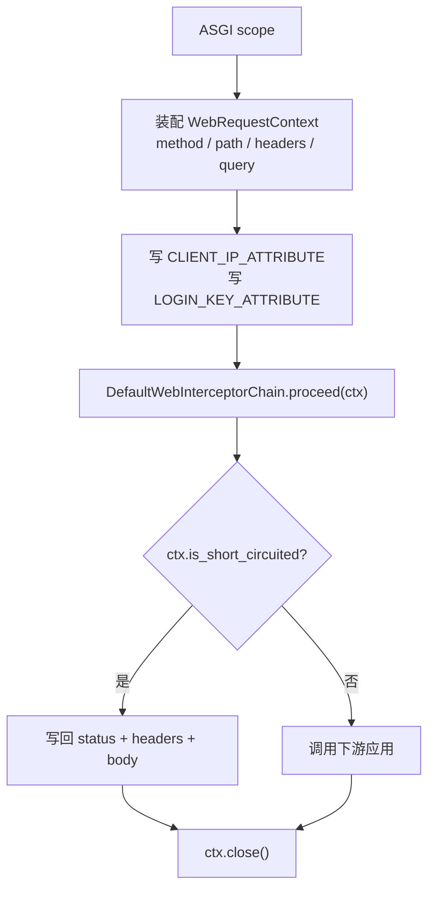
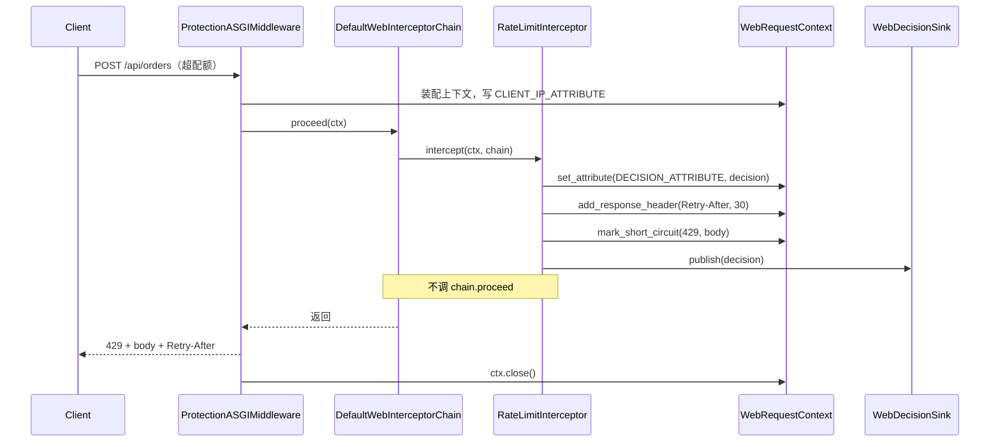

# atlas-richie-web-protection-adapter-asgi

ASGI 中间件：把 atlas-richie-web-protection 的 guard 接进请求处理 —— 现在是
通过共享的**拦截器链**与共享的**决策事件**。纯 ASGI：不依赖 Starlette，
不依赖任何框架。

这些 guard 是**服务端**防护，所以接入点就是 ASGI 中间件。atlas_richie.http 的
拦截器链是**客户端**门面，故刻意不使用。

只依赖 atlas-richie-web-protection；零依赖内核不被适配层污染。

[English](./README.md) | 简体中文

## 📖 目录

- [🎯 组件概览](#-组件概览)
  - [核心能力](#核心能力)
- [🏗️ 架构设计](#-架构设计)
  - [请求处理流程](#请求处理流程)
  - [链装配顺序](#链装配顺序)
- [🚀 快速开始](#-快速开始)
- [📚 接口参考](#-接口参考)
  - [构造参数](#构造参数)
  - [公共辅助函数](#公共辅助函数)
- [🔧 核心场景](#-核心场景)
  - [场景 1：观测每一次拒绝](#场景-1观测每一次拒绝)
  - [场景 2：长连接路径](#场景-2长连接路径)
  - [场景 3：网关身份旁路](#场景-3网关身份旁路)
  - [场景 4：登录失败跟踪](#场景-4登录失败跟踪)
  - [场景 5：分布式限流](#场景-5分布式限流)
  - [场景 6：trace 归一](#场景-6trace-归一)
- [⚙️ 与 Java 基准的差异](#-与-java-基准的差异)
- [🔧 排障](#-排障)
- [📎 ⏱️ 时序图](#-时序图)
  - [被拒绝的请求](#被拒绝的请求)

## 🎯 组件概览

本中间件是**唯一**的 ASGI 适配点（Java 侧也只有一个：`InterceptingFilter`）。
它把 ASGI scope 装配成 `WebRequestContext`，驱动拦截器链；一旦某个 guard 短路，
就按上下文里的状态码、响应头、body 写回，而**不**调用下游应用。

### 核心能力

- ✅ **链驱动**：每个 guard 都是一个拦截器；中间件只负责装配链与渲染结果
- ✅ **统一决策事件**：传 `decision_sink`，每一次拒绝都会带着 interceptor、
  key、status、reason 上报
- ✅ **拒绝字节不变**：状态码、body、响应头与 Content-Length 与改造前的
  内联实现完全一致
- ✅ **框架无关**：链可以被任何适配层复用；中间件本身不含任何防护逻辑
- ✅ **guard 全可选**：一个都不配时中间件就是透传
- ✅ **非 http scope**：lifespan 与 websocket 直接放行

## 🏗️ 架构设计

### 请求处理流程



### 链装配顺序

由廉价到昂贵，让被拒请求的代价尽可能小。顺序与改造前的内联实现逐项对齐。

| # | 拦截器 | 加入条件 | 拒绝语义 |
| --- | --- | --- | --- |
| 1 | `TraceIdInterceptor` | `enable_trace_id` 为 True（默认） | 从不拒绝 |
| 2 | `IpBlacklistInterceptor` | `ip_blacklist` 非空 | 403 `ip_blacklisted` |
| 3 | `GatewayBypassInterceptor` | `gateway_bypass_header` 不为 None | 从不拒绝 |
| 4 | `LongLivedBypassInterceptor` | `long_lived_bypass` 不为 None | 从不拒绝 |
| 5 | `BotUserAgentInterceptor` | `bot_matchers` 非空 | 403 `bot_detected` |
| 6 | `RequestSizeInterceptor` | 配了 `size_guard` | 413 / 431 |
| 7 | `LoginLockInterceptor` | 配了 `login_tracker` | 429 `account_locked` |
| 8 | `IdempotencyInterceptor` | 配了 `idempotency_guard` | 409 `idempotent_replay` |
| 9 | `RateLimitInterceptor` | 配了 `rate_limit_guard` | 429 / 401 |
| 10 | `SignatureInterceptor` | 配了 `signature_verifier` | 401 + 校验器原因 |

网关身份层始终在链里 —— 它只写 attribute、从不拒绝，所以即使一个 guard 都没配，
链也不会是空的。trace 拦截器**排第一**（Java 的 `ORDER = 50`），后面的拦截器
才读得到 `ctx.trace_id`。

## 🚀 快速开始

```python
from atlas_richie.web_protection import (
    ApiSignatureVerifier, BotUserAgentMatcher, IpBlacklistEntry,
    LoginAttemptTracker, NonceCache, RequestSizeGuard,
)
from atlas_richie.web_protection_adapter_asgi import ProtectionASGIMiddleware

app = ProtectionASGIMiddleware(
    my_asgi_app,
    ip_blacklist=[IpBlacklistEntry("10.0.0.0/8")],
    bot_matchers=[BotUserAgentMatcher("*curl*")],
    size_guard=RequestSizeGuard(max_body_bytes=1_048_576, max_header_bytes=16_384),
    signature_verifier=ApiSignatureVerifier(key_provider, NonceCache(300), 60),
    login_tracker=LoginAttemptTracker(window_seconds=300, max_attempts=5, lockout_seconds=900),
)
```

每个 guard 都是可选的；一个都不配时中间件就是透传。非 http scope
（含 lifespan 与 websocket）直接放行。

## 📚 接口参考

### 构造参数

| 参数 | 默认值 | 含义 |
| --- | --- | --- |
| app | — | 下游 ASGI 应用 |
| `ip_blacklist` | () | `IpBlacklistEntry` 列表 |
| `bot_matchers` | () | `BotUserAgentMatcher` 列表 |
| `size_guard` | None | `RequestSizeGuard` 实例 |
| `signature_verifier` | None | `ApiSignatureVerifier` 实例 |
| `rate_limit_guard` | None | `RateLimitGuard` 实例 |
| `idempotency_guard` | None | `IdempotencyGuard` 实例 |
| `long_lived_bypass` | None | `LongLivedPathBypass` 实例 |
| `login_tracker` | None | `LoginAttemptTracker` 实例 |
| `login_paths` | (/login, /api/user/login, /oauth2/token) | 纳入登录结果跟踪的路径 |
| `login_key` | 客户端 IP | 可调用对象 (scope, headers) -> key 或 None |
| `client_key_header` | `x-client-key` | 携带客户端 key 的 header |
| `trust_forwarded` | False | 用 `X-Forwarded-For` 首跳作为客户端 IP |
| `gateway_bypass_header` | `x-forwarded-from-gateway` | 证明请求来自网关的 header；None 表示关闭旁路 |
| `deny_renderer` | {"error": reason} JSON | 可调用对象 (status, reason) -> bytes |
| `deny_status_ip` | 403 | IP 黑名单的拒绝状态码 |
| `deny_status_bot` | 403 | bot User-Agent 的拒绝状态码 |
| `deny_status_signature` | 401 | 签名失败的拒绝状态码 |
| `deny_status_locked` | 429 | 账号锁定的拒绝状态码 |
| `decision_sink` | None | 带 `publish(decision)` 的对象，接收每一次拒绝 |
| `enable_trace_id` | True | 归一 trace id 并下发 `X-Trace-Id` 响应头 |

### 公共辅助函数

| 辅助函数 | 含义 |
| --- | --- |
| `header_map(scope)` | 单值 header map，同名后者覆盖前者 |
| client_ip(scope, headers, `trust_forwarded`=False) | 请求的客户端 IP |
| default_deny_body(reason) | 默认拒绝 body（bytes） |
| DEFAULT_LOGIN_PATHS | 默认登录路径 |

## 🔧 核心场景

### 场景 1：观测每一次拒绝

```python
class AuditSink:
    def publish(self, decision: WebFilterDecision) -> None:
        audit.record(
            interceptor=decision.interceptor,
            key=decision.key,
            status=decision.status,
            reason=decision.reason,
        )

middleware = ProtectionASGIMiddleware(app, decision_sink=AuditSink())
```

sink 只会被调用**一次** —— 链在第一次拒绝处就停了，与 Java 侧「先触发者为准」
一致。

### 场景 2：长连接路径

命中 `LongLivedPathBypass` 的路径（SSE/WebSocket）会跳过所有请求级 guard 直接
放行 —— 它们是长流，不是一次性请求。IP 黑名单仍然生效（它排在最前）。

在链里这表现为一个标志而非提前返回：长连接拦截器置上 `LONG_LIVED_ATTRIBUTE`，
各请求级拦截器在动作前自行检查该标志 —— 与 Java 拦截器的 attribute 自查
同一套模式。

体积 guard 只读 Content-Length —— 它从不消费请求体，下游处理仍能拿到完整流。

### 场景 3：网关身份旁路

`gateway_bypass_header`（默认 `x-forwarded-from-gateway`，与 Java 的
`PlatformProtectionInterceptor` 读的是同一个头）存在时跳过签名校验，与 Java
拦截器的网关旁路行为一致。设为 None 可关闭。
**只有在你信任的网关会剥离或重写该 header 时才开启**，否则客户端可以伪造。

### 场景 4：登录失败跟踪

对 `login_paths` 里的路径，中间件包装 send 从下游响应里学习：2xx 记成功，
401/403 记失败。被锁定的 key 在调用应用之前就被拒。跟踪 key 默认取客户端 IP；
传 `login_key` 可以改成按用户名或租户。

「学习」这一半留在适配层，因为它观察的是**响应**；Java 侧由独立的
`RequestLifecycleHookInterceptor` 负责，属于 hook bus 那一项 BACKLOG。

### 场景 5：分布式限流

传一个 `RateLimitGuard`（来自 atlas_richie.web_protection），接到任意 LimiterOps
实现上 —— cache-redis 的 `RedisProviderRegistrar`.`limiter_ops()` 就是固定窗口
Redis 计数器。检查排在 IP/bot/锁定之后、签名校验之前，与 Java 的拦截器顺序一致。

```python
from atlas_richie.cache_redis import RedisProviderRegistrar
from atlas_richie.web_protection import (
    CompositeKeyResolver, HeaderClientKeyResolver, IpClientKeyResolver,
    RateLimitGuard, RateLimitProperties, RateLimitRoute,
)
from atlas_richie.web_protection_adapter_asgi import ProtectionASGIMiddleware

registrar = RedisProviderRegistrar(client)
guard = RateLimitGuard(
    registrar.limiter_ops(),
    RateLimitProperties(routes=(RateLimitRoute("/api/**", permits_per_second=50),)),
    CompositeKeyResolver(HeaderClientKeyResolver(), IpClientKeyResolver()),
)
middleware = ProtectionASGIMiddleware(app, rate_limit_guard=guard)
```

路由先精确匹配，再走 Ant 风格模式（* 不跨 /，** 跨任意深度，{var} 匹配一段）。
默认要求 `X-Forwarded-From-Gateway` 身份；client key 取自 `x-client-key`，回落到 IP。
拒绝时用逐路由配置的状态码/code/message/headers，其中 {key} 会被替换成实际
client key。

### 场景 6：trace 归一

每个请求都会拿到一个归一后的 32-hex trace id：先看 W3C `traceparent` 头，
再看 `X-Request-Id`，都没有就自生成。

```python
middleware = ProtectionASGIMiddleware(app)   # trace 归一默认开启
```

响应在**正常路径与短路路径**都会带上 `X-Trace-Id`。传
`enable_trace_id=False` 可整体关闭。

trace 拦截器排第一（Java 的 `ORDER = 50`），所以 `ctx.trace_id` 对后面每个
拦截器都可用。

## ⚙️ 与 Java 基准的差异

| 主题 | Java | Python | 原因 |
| --- | --- | --- | --- |
| 适配点数量 | 一个 servlet filter（`InterceptingFilter`） | 一个 ASGI 中间件 | 同一条规则：单一适配点 |
| 链形态 | 同步、游标式 | 同步、游标式 | 所有 guard 都是同步的；应用在链之后调用 |
| 决策发布 | `HookBus` | 可选 `decision_sink` + 上下文 attribute | hook bus 是 BACKLOG 的另一项 |
| 网关旁路 | 硬编码 | 头名可配置 | 保留 Java 默认契约 |
| 登录结果学习 | `RequestLifecycleHookInterceptor` | 适配层实现，观察响应 | hook bus 是 BACKLOG 的另一项 |
| 拒绝 body | Java String | 上下文里是 Python str，落到线上是 bytes | 适配层用 surrogateescape 重新编码，自定义 bytes 逐字节不变 |
| 重复 header | 收全部值 | 收全部值 | 对位 Java；单值 `header_map()` 保持自己的契约 |
| `X-Trace-Id` 写回 | 只在短路路径写；正常路径靠容器层 `TraceIdInjectValve` | 两条路径都写 | ASGI 中间件**就是**容器层，注入得自己干 —— 否则正常响应永远带不上 trace id |
| 平台头 vs 应用头 | — | 同名以平台为准 | 线上看到的 `X-Trace-Id` 永远等于 `ctx.trace_id`，两者不分叉 |
| trace 拦截器 | `OtelTracingInterceptor`，有 observability starter 时不装配 | `TraceIdInterceptor`，始终装配 | Java 的旧 web tracing 不能与 OTel trace 边界并存；Python 的 observability 组件落地后需沿用同一条互斥规则 |

## 🔧 排障

| 现象 | 原因 | 处理 |
| --- | --- | --- |
| 拒绝没有上报 | 没配 sink | 传 `decision_sink`=... |
| 拒绝后上下文 attribute 为空 | 读了别的 attribute 名 | 用导出的 `DECISION_ATTRIBUTE` 常量 |
| 长连接路径仍被拒 | IP 黑名单排在长连接旁路之前 | 刻意为之 —— 黑名单对所有路径生效 |
| 自定义 `deny_renderer` 的输出变了 | 渲染器必须返回 bytes | 适配层会按 UTF-8 重新编码 body |
| 登录跟踪一直没有记录 | 路径不在 `login_paths` 里 | 加上，或传 `login_paths`=... |

## 📎 ⏱️ 时序图

### 被拒绝的请求


