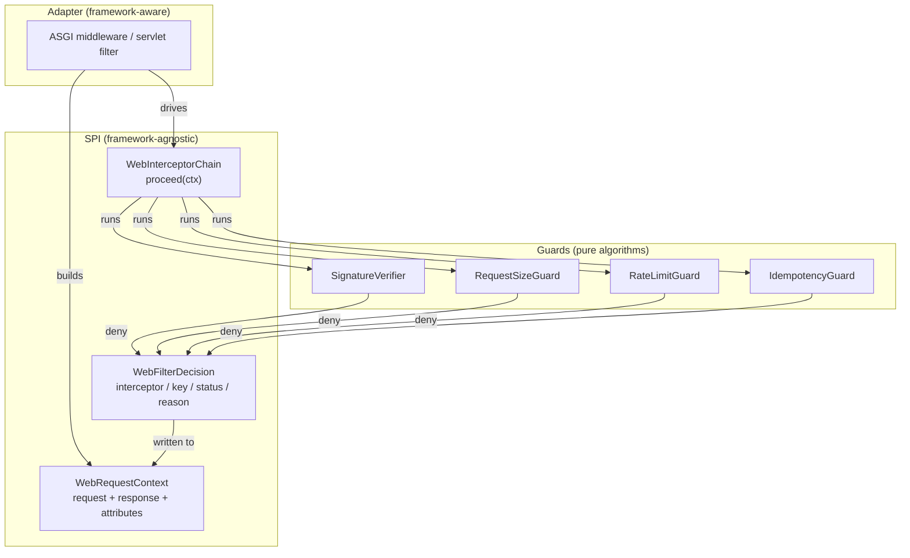
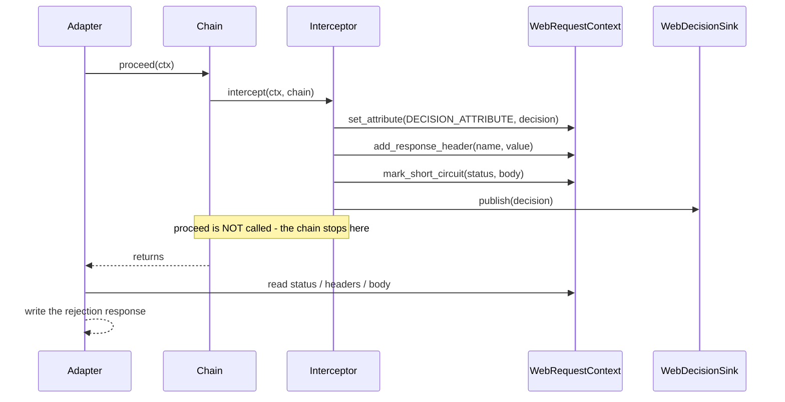
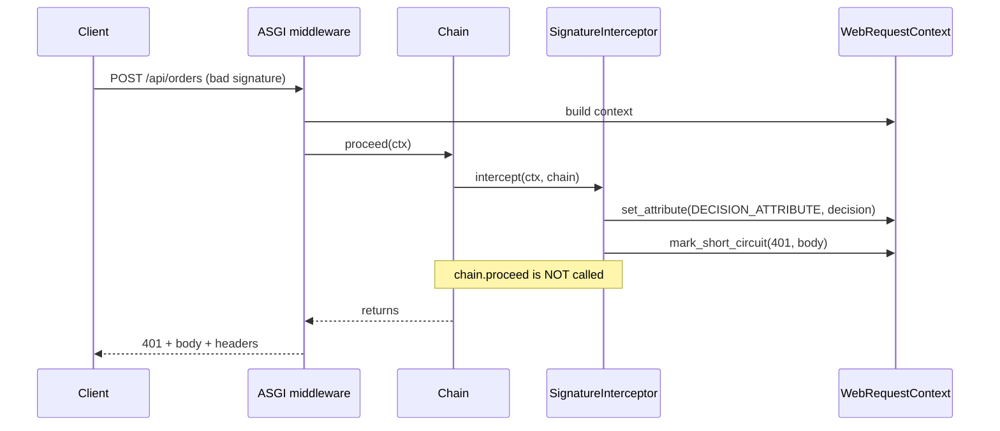
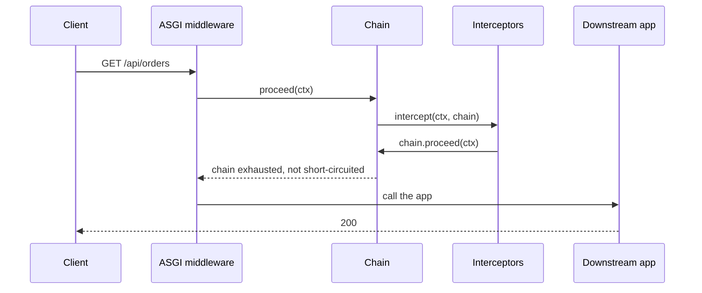

# atlas-richie-web-protection

Request protection algorithms and the container-agnostic decision SPI behind
them: HMAC request signing, nonce replay detection, login brute-force lockout,
bot User-Agent matching, IP/CIDR blacklists and request size limits — plus the
**interceptor chain** that folds per-guard verdicts into one observable
decision event.

**Zero runtime dependencies.** Sentinel already covers rate limiting and circuit
breaking; these are the request-level protections Python was missing.

## 📖 Table of Contents

- [🎯 Component Overview](#-component-overview)
  - [Key Features](#key-features)
- [🏗️ Architecture Design](#-architecture-design)
  - [Layering](#layering)
  - [The SPI Contract](#the-spi-contract)
  - [Guard → Interceptor Adapters](#guard--interceptor-adapters)
  - [Decision Event Flow](#decision-event-flow)
- [🚀 Quick Start](#-quick-start)
  - [1. Build a request context](#1-build-a-request-context)
  - [2. Drive an interceptor chain](#2-drive-an-interceptor-chain)
  - [3. Use a guard directly](#3-use-a-guard-directly)
- [📚 Interface Reference](#-interface-reference)
  - [`WebRequestContext`](#webrequestcontext)
  - [`WebFilterDecision`](#webfilterdecision)
  - [`WebInterceptor` and the Chain](#webinterceptor-and-the-chain)
  - [Attribute Names](#attribute-names)
- [🔧 Core Capabilities](#-core-capabilities)
  - [Scenario 1: One decision event for every rejection](#scenario-1-one-decision-event-for-every-rejection)
  - [Scenario 2: Adding your own interceptor](#scenario-2-adding-your-own-interceptor)
- [⚙️ Differences from the Java Baseline](#-differences-from-the-java-baseline)
- [🔧 Troubleshooting](#-troubleshooting)
- [📎 ⏱️ Sequence Diagrams](#-sequence-diagrams)
  - [Rejecting a Request](#rejecting-a-request)
  - [Passing a Request Through](#passing-a-request-through)

## 🎯 Component Overview

Ported from the Java atlas-richie-web-core protection package and its spi
package. The algorithms are unchanged; what this release adds is the
**decision contract** the Java side already had: one request context, one
interceptor chain, one decision event.

### Key Features

- ✅ **One decision event**: every rejection carries a `WebFilterDecision`
  (interceptor / key / status / reason), written to the request context and
  optionally published to a sink
- ✅ **Container-agnostic SPI**: interceptors only see a `WebRequestContext`,
  never a framework request object
- ✅ **Short-circuit, not exceptions**: an interceptor marks the context short
  and does **not** call `chain.proceed(ctx)`; exceptions stay reserved for
  genuine faults and are turned into 5xx by the adapter
- ✅ **Guard reuse**: the existing guards (signature, size, idempotency, rate
  limit, …) are wrapped as interceptors instead of being reimplemented
- ✅ **Attribute self-check**: cross-cutting flags (gateway bypass, long-lived
  path) live on the context and are checked by the interceptors that care —
  the same pattern the Java interceptors use
- ✅ **Zero runtime dependencies**: no Redis, no framework, no Spring
- ✅ **Idempotent lifecycle**: `ctx.close()` may be called any number of times

## 🏗️ Architecture Design

### Layering

| Layer | Module | Depends on | Responsibility |
| --- | --- | --- | --- |
| SPI contract | atlas_richie.web_protection.spi | stdlib only | Context, decision event, interceptor and chain protocols |
| SPI defaults | atlas_richie.web_protection.spi.support | stdlib only | `MutableWebRequestContext`, `DefaultWebInterceptorChain` |
| Guard adapters | atlas_richie.web_protection.interceptors | guards | Wraps each guard as an interceptor |
| Guards | guards / rate_limit / idempotency / matchers / trackers | stdlib only | Pure allow/deny decisions |
| Adapter | atlas-richie-web-protection-adapter-asgi | this package | Wires the chain into a framework |

The SPI layers know nothing about HTTP servers; the adapter layers know nothing
about the algorithms. That split is what makes the same chain usable from
ASGI, from a servlet bridge, or from a test.

### The SPI Contract



### Guard → Interceptor Adapters

Every guard becomes an interceptor that owns its rejection semantics — status
code, reason, response headers and body template — exactly like the Java
interceptors do.

| Python interceptor | Java counterpart | Rejection |
| --- | --- | --- |
| `IpBlacklistInterceptor` | `AnomalyDetectionInterceptor` (IP branch) | 403 `ip_blacklisted` |
| `BotUserAgentInterceptor` | `AnomalyDetectionInterceptor` (bot branch) | 403 `bot_detected` |
| `GatewayBypassInterceptor` | `PlatformProtectionInterceptor` (gateway branch) | never rejects |
| `RequestSizeInterceptor` | `PlatformProtectionInterceptor` (size branch) | 413 / 431 |
| `LongLivedBypassInterceptor` | `LongLivedPathBypass` | never rejects |
| `LoginLockInterceptor` | `BruteForceInterceptor` | 429 `account_locked` |
| `SignatureInterceptor` | `ApiSignatureInterceptor` | 401 + verifier reason |
| `IdempotencyInterceptor` | business.`IdempotencyInterceptor` | 409 `idempotent_replay` |
| `RateLimitInterceptor` | `DistributedRateLimitInterceptor` | 429 / 401 + guard reason |

### Decision Event Flow



## 🚀 Quick Start

### 1. Build a request context

```python
from atlas_richie.web_protection.spi import MutableWebRequestContext

ctx = MutableWebRequestContext(
    method="POST",
    path="/api/orders",
    headers={"x-client-key": ["partner-1"], "content-length": ["128"]},
    query_params={"dry_run": ["true"]},
)
ctx.path_variables()          # {}
ctx.header("x-client-key")    # "partner-1" (first value, case-insensitive)
ctx.header_names()            # ["x-client-key", "content-length"]
```

Header values may be a list of strings or a plain string — a plain string is
treated as **one** value, never split into characters.

### 2. Drive an interceptor chain

```python
from atlas_richie.web_protection import RequestSizeGuard
from atlas_richie.web_protection.interceptors import RequestSizeInterceptor
from atlas_richie.web_protection.spi import DefaultWebInterceptorChain

chain = DefaultWebInterceptorChain([RequestSizeInterceptor(RequestSizeGuard(1_048_576, 16_384))])
chain.proceed(ctx)

if ctx.is_short_circuited:
    print(ctx.response_status, ctx.short_circuit_body)
```

### 3. Use a guard directly

Guards stay usable on their own — they return **decisions** and leave rendering
to the caller.

```python
from atlas_richie.web_protection import (
    ApiSignatureVerifier, NonceCache, LoginAttemptTracker,
    BotUserAgentMatcher, IpBlacklistEntry, RequestSizeGuard,
)

class Keys:
    def secret_for(self, client_key: str) -> bytes | None:
        return load_from_vault(client_key)

verifier = ApiSignatureVerifier(Keys(), NonceCache(ttl_seconds=300), timestamp_skew_seconds=60)
decision = verifier.verify(
    method="POST", path="/api/orders", client_key="partner-1",
    timestamp="1700000000000", nonce="abc123", signature="<hex>",
)
if decision is not None:
    deny(decision.reason)   # missing_header | bad_timestamp | timestamp_skew
                            # nonce_replay | no_secret | signature_mismatch
```

Signing canonical string: method + newline + path + newline + timestamp +
newline + nonce, HMAC-SHA256, **lower-case hex**, compared in constant time.

## 📚 Interface Reference

### `WebRequestContext`

Read-only inbound, writable outbound, plus a lifecycle. Python naming rule:
**scalars are properties, collections and lookups are methods, writes are
explicit setters.**

| Member | Kind | Meaning |
| --- | --- | --- |
| method | property | HTTP method, upper-cased |
| path | property | request path, no query string |
| header(name) | method | first value of a header, case-insensitive, None if absent |
| headers(name) | method | all values of a header, [] if absent |
| `header_names`() | method | all header names, lower-cased |
| query_param(name) | method | first value of a query parameter |
| `query_params`() | method | all query parameters |
| `path_variables`() | method | path variables resolved by the router |
| attribute(name) | method | read a cross-interceptor attribute |
| `set_attribute`(name, value) | method | write an attribute, returns the previous value |
| remove_attribute(name) | method | delete an attribute, returns the previous value |
| `response_status` | property | response status, starts at 200 |
| set_response_status(status) | method | set the response status |
| `response_headers`() | method | live view of the response headers |
| `add_response_header`(name, value) | method | add a response header (same name overwrites) |
| client_key | property | client key resolved by a key resolver |
| set_client_key(key) | method | set the client key |
| trace_id | property | trace id |
| set_trace_id(trace_id) | method | set the trace id |
| `is_short_circuited` | property | whether an interceptor short-circuited |
| `mark_short_circuit`(status, body) | method | mark the short circuit |
| `short_circuit_body` | property | short-circuit body template, None if not short-circuited |
| error | property | exception raised on this request, if any |
| set_error(error) | method | set the exception (overwrites) |
| start_nanos | property | request start time on a monotonic clock |
| close() | method | release resources — **idempotent** |

### `WebFilterDecision`

Frozen, four fields, same order as the Java record.

| Field | Type | Meaning |
| --- | --- | --- |
| interceptor | str | which interceptor decided (class name) |
| key | str or None | the decision key (rate-limit key, login key, …) |
| status | int | HTTP status of the rejection |
| reason | str | machine-readable reason (`ip_blacklisted`, nonce_replay, …) |

`is_deny` is true when status is 400 or more. Two factory methods mirror the Java
record: `WebFilterDecision`.rate_limit_deny(...) produces the reason
`rate_limit.exceeded` and `WebFilterDecision`.circuit_breaker_deny(...) produces
`circuit_breaker.open`.

A `WebDecisionSink` is any object with `publish(decision)` returning None.

### `WebInterceptor` and the Chain

```python
class MyInterceptor:
    def intercept(self, ctx: WebRequestContext, chain: WebInterceptorChain) -> None:
        if ctx.header("x-tenant") is None:
            ctx.set_attribute(DECISION_ATTRIBUTE, WebFilterDecision(
                "MyInterceptor", None, 400, "tenant.missing"))
            ctx.mark_short_circuit(400, '{"error": "tenant.missing"}')
            return          # <- do NOT call chain.proceed(ctx)
        chain.proceed(ctx)
```

`DefaultWebInterceptorChain` drives interceptors in registration order. proceed
is a no-op when the context is already short-circuited or when the chain has
reached its end. The chain is **not thread-safe** — one instance per request.

### Attribute Names

| Constant | Value | Written by | Read by |
| --- | --- | --- | --- |
| `DECISION_ATTRIBUTE` | `platform.web.filter-decision` | every denying interceptor | your sink / hook |
| `GATEWAY_BYPASS_ATTRIBUTE` | `platform.web.gateway-bypass` | `GatewayBypassInterceptor` | `SignatureInterceptor` |
| `GATEWAY_ID_ATTRIBUTE` | `platform.web.gateway-id` | `GatewayBypassInterceptor` | your code |
| `LONG_LIVED_ATTRIBUTE` | `platform.web.long-lived` | `LongLivedBypassInterceptor` | request-level interceptors |
| `CLIENT_IP_ATTRIBUTE` | `platform.web.client-ip` | the adapter | `RateLimitInterceptor` |
| `LOGIN_KEY_ATTRIBUTE` | `platform.web.login-key` | the adapter | `LoginLockInterceptor` |

The first four names are byte-identical to the Java constants.

## 🔧 Core Capabilities

### Scenario 1: One decision event for every rejection

Wire a sink once and every rejection becomes observable, whatever guard
produced it.

```python
class LoggingSink:
    def publish(self, decision: WebFilterDecision) -> None:
        log.warning("rejected by %s: %s (status=%s)",
                    decision.interceptor, decision.reason, decision.status)

middleware = ProtectionASGIMiddleware(app, decision_sink=LoggingSink())
```

The event is **not** skipped for rejected requests — the Java side has the same
red line: a rejected request must still report *why* it was rejected.

### Scenario 2: Adding your own interceptor

Interceptors are plain objects. Compose your own chain without touching the
framework:

```python
chain = DefaultWebInterceptorChain([
    TenantInterceptor(),
    *middleware.interceptors,
])
```

## ⚙️ Differences from the Java Baseline

| Topic | Java | Python | Why |
| --- | --- | --- | --- |
| Decision attribute | one name per interceptor (platform.web.signature-decision, …) | one unified name `platform.web.filter-decision` | the BACKLOG asks for a **unified** decision event, and Python has no hook bus yet — the attribute is the only hand-off channel |
| Event publication | `HookBus` (publish is never skipped by a short circuit) | optional `WebDecisionSink` + the context attribute | the hook bus is a separate BACKLOG item |
| Rate-limit reason | fixed `rate_limit.exceeded` | `rate_limited` / `gateway_identity_missing` / `client_unidentified` | keeps "quota exhausted" distinguishable from "identity missing" |
| Gateway bypass | hard-coded, cannot be disabled | configurable header name (default `x-forwarded-from-gateway`) | keeps the Java default contract while staying operable |
| Circuit breaker | `CircuitBreakerInterceptor` | not ported | the breaker state machine is not a request-level guard |
| Login outcome learning | `RequestLifecycleHookInterceptor` | still in the adapter | the hook bus is a separate BACKLOG item |
| Duplicate headers | `getHeader()` returns the first value | ctx.header() returns the first value; `header_map_from_context`() returns the last | the context follows Java; the single-value map keeps the ASGI adapter's existing `header_map()` contract |

The IP-blacklist hardening deviation from the Java side is unchanged:
Java's `IpBlacklistEntry` resolves hostnames through DNS, which turns a
blacklist check into an outbound name query. This port accepts IP literals
only, so a hostname never matches.

## 🔧 Troubleshooting

| Symptom | Cause | Fix |
| --- | --- | --- |
| The chain never rejects anything | guards were never wrapped into interceptors | build the chain through the adapter, or add the interceptor yourself |
| ctx.attribute(`DECISION_ATTRIBUTE`) is None after a rejection | the interceptor was not used, or a different attribute name was read | use the exported constant, not a literal |
| A long-lived (SSE) path is still rejected | the IP blacklist runs before the long-lived bypass | that is intentional — the blacklist applies to every path |
| A custom `deny_renderer` output changed | the renderer must return bytes | the adapter re-encodes the body as UTF-8; return bytes to keep them byte-identical |
| Rejections are counted but never reported | no sink was configured | pass `decision_sink`=... to the middleware |

## 📎 ⏱️ Sequence Diagrams

### Rejecting a Request



### Passing a Request Through


