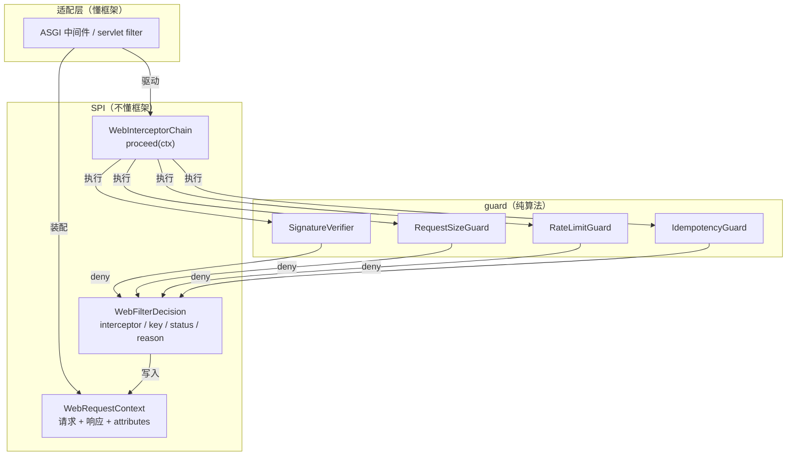
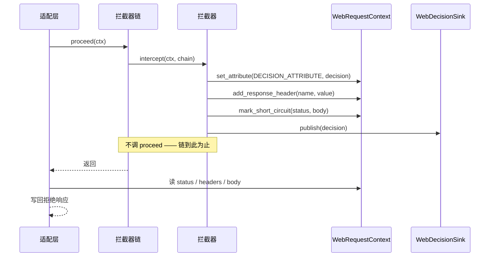
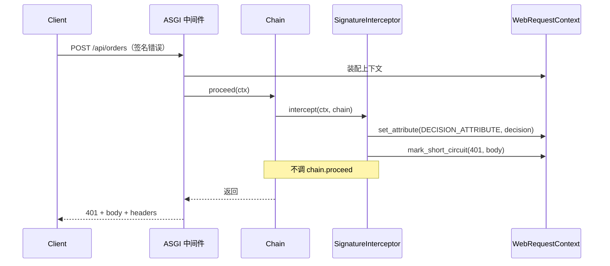
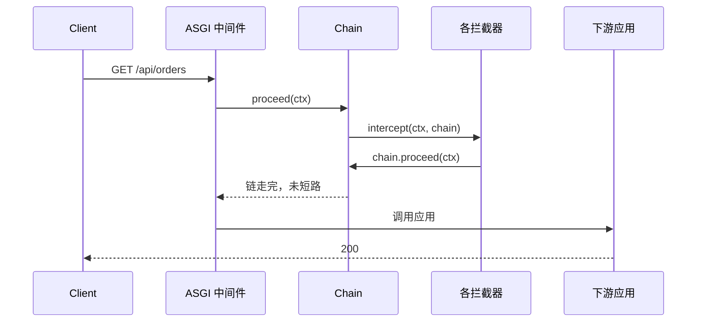

# atlas-richie-web-protection

请求防护算法，以及它们背后的**容器无关决策 SPI**：HMAC 请求签名、nonce 重放
检测、登录暴力破解锁定、bot User-Agent 匹配、IP/CIDR 黑名单、请求体积上限 ——
再加上把各 guard 的判定收敛成**一个决策事件**的**拦截器链**。

**零运行时依赖。** 限流与熔断已由 Sentinel 覆盖，这些是 Python 侧原本缺失的
请求级防护。

[English](./README.md) | 简体中文

## 📖 目录

- [🎯 组件概览](#-组件概览)
  - [核心能力](#核心能力)
- [🏗️ 架构设计](#-架构设计)
  - [分层](#分层)
  - [SPI 契约层](#spi-契约层)
  - [guard → 拦截器适配](#guard--拦截器适配)
  - [决策事件流](#决策事件流)
- [🚀 快速开始](#-快速开始)
  - [1. 装配请求上下文](#1-装配请求上下文)
  - [2. 驱动拦截器链](#2-驱动拦截器链)
  - [3. 直接使用 guard](#3-直接使用-guard)
- [📚 接口参考](#-接口参考)
  - [`WebRequestContext`](#webrequestcontext)
  - [`WebFilterDecision`](#webfilterdecision)
  - [`WebInterceptor` 与拦截器链](#webinterceptor-与拦截器链)
  - [attribute 常量](#attribute-常量)
  - [trace id 归一化](#trace-id-归一化)
- [🔧 核心场景](#-核心场景)
  - [场景 1：每一次拒绝都有唯一决策事件](#场景-1每一次拒绝都有唯一决策事件)
  - [场景 2：接入自己的拦截器](#场景-2接入自己的拦截器)
- [⚙️ 与 Java 基准的差异](#-与-java-基准的差异)
- [🔧 排障](#-排障)
- [📎 ⏱️ 时序图](#-时序图)
  - [拒绝一个请求](#拒绝一个请求)
  - [放行一个请求](#放行一个请求)

## 🎯 组件概览

移植自 Java 的 atlas-richie-web-core protection 包与 spi 包。算法本身没有变化；
本次新增的是 Java 侧本就存在的**决策契约**：一个请求上下文、一条拦截器链、
一个决策事件。

### 核心能力

- ✅ **统一决策事件**：每一次拒绝都带一个 `WebFilterDecision`
  （interceptor / key / status / reason），写进请求上下文，并可选投递给 sink
- ✅ **容器无关 SPI**：拦截器只面向 WebRequestContext编程，不接触任何框架请求对象
- ✅ **短路而非抛异常**：拦截器标记短路并且**不**调 `chain.proceed(ctx)`；
  异常留给真正的故障，由适配层兜底成 5xx
- ✅ **复用 guard**：既有的签名、体积、幂等、限流等 guard 被**包装**成拦截器，
  而不是重新实现一遍
- ✅ **attribute 自查**：跨切面标志（网关身份、长连接路径）挂在上下文上，
  由关心它们的拦截器自行判断 —— 与 Java 拦截器同一套模式
- ✅ **零运行时依赖**：无 Redis、无框架、无 Spring
- ✅ **幂等生命周期**：`ctx.close()` 可以被调用任意次

## 🏗️ 架构设计

### 分层

| 层 | 模块 | 依赖 | 职责 |
| --- | --- | --- | --- |
| SPI 契约 | atlas_richie.web_protection.spi | 仅标准库 | 上下文、决策事件、拦截器与链的协议 |
| SPI 默认实现 | atlas_richie.web_protection.spi.support | 仅标准库 | `MutableWebRequestContext`、`DefaultWebInterceptorChain` |
| guard 适配 | atlas_richie.web_protection.interceptors | 各 guard | 把每个 guard 包成拦截器 |
| trace 归一 | atlas_richie.web_protection.tracing | 仅标准库 | `TraceIdParser` + `TraceIdInterceptor` —— trace id 归一化 |
| guard | guards / rate_limit / idempotency / matchers / trackers | 仅标准库 | 纯 allow/deny 判定 |
| 适配层 | atlas-richie-web-protection-adapter-asgi | 本包 | 把链接进具体框架 |

SPI 层不认识任何 HTTP 服务器；适配层不认识任何算法。正是这个切分让同一条链
既能被 ASGI 用，也能被 servlet 桥接用，还能在测试里用。

### SPI 契约层



### guard → 拦截器适配

每个 guard 都变成一个拦截器，自带拒绝语义 —— 状态码、原因、响应头、body 模板 ——
与 Java 拦截器完全同构。

| Python 拦截器 | Java 对应物 | 拒绝语义 |
| --- | --- | --- |
| `IpBlacklistInterceptor` | `AnomalyDetectionInterceptor`（IP 分支） | 403 `ip_blacklisted` |
| `BotUserAgentInterceptor` | `AnomalyDetectionInterceptor`（bot 分支） | 403 `bot_detected` |
| `GatewayBypassInterceptor` | `PlatformProtectionInterceptor`（网关分支） | 从不拒绝 |
| `RequestSizeInterceptor` | `PlatformProtectionInterceptor`（体积分支） | 413 / 431 |
| `LongLivedBypassInterceptor` | `LongLivedPathBypass` | 从不拒绝 |
| `LoginLockInterceptor` | `BruteForceInterceptor` | 429 `account_locked` |
| `SignatureInterceptor` | `ApiSignatureInterceptor` | 401 + 校验器原因 |
| `IdempotencyInterceptor` | business.`IdempotencyInterceptor` | 409 `idempotent_replay` |
| `RateLimitInterceptor` | `DistributedRateLimitInterceptor` | 429 / 401 + guard 原因 |

### 决策事件流



## 🚀 快速开始

### 1. 装配请求上下文

```python
from atlas_richie.web_protection.spi import MutableWebRequestContext

ctx = MutableWebRequestContext(
    method="POST",
    path="/api/orders",
    headers={"x-client-key": ["partner-1"], "content-length": ["128"]},
    query_params={"dry_run": ["true"]},
)
ctx.path_variables()          # {}
ctx.header("x-client-key")    # "partner-1"（第一个值，大小写不敏感）
ctx.header_names()            # ["x-client-key", "content-length"]
```

header 的值既可以是字符串列表，也可以是单个字符串 —— 单个字符串按**一个值**
处理，绝不会被拆成字符。

### 2. 驱动拦截器链

```python
from atlas_richie.web_protection import RequestSizeGuard
from atlas_richie.web_protection.interceptors import RequestSizeInterceptor
from atlas_richie.web_protection.spi import DefaultWebInterceptorChain

chain = DefaultWebInterceptorChain([RequestSizeInterceptor(RequestSizeGuard(1_048_576, 16_384))])
chain.proceed(ctx)

if ctx.is_short_circuited:
    print(ctx.response_status, ctx.short_circuit_body)
```

### 3. 直接使用 guard

guard 依然可以单独使用 —— 它们返回**判定**，渲染留给调用方。

```python
from atlas_richie.web_protection import (
    ApiSignatureVerifier, NonceCache, LoginAttemptTracker,
    BotUserAgentMatcher, IpBlacklistEntry, RequestSizeGuard,
)

class Keys:
    def secret_for(self, client_key: str) -> bytes | None:
        return load_from_vault(client_key)

verifier = ApiSignatureVerifier(Keys(), NonceCache(ttl_seconds=300), timestamp_skew_seconds=60)
decision = verifier.verify(
    method="POST", path="/api/orders", client_key="partner-1",
    timestamp="1700000000000", nonce="abc123", signature="<hex>",
)
if decision is not None:
    deny(decision.reason)   # missing_header | bad_timestamp | timestamp_skew
                            # nonce_replay | no_secret | signature_mismatch
```

签名规范串：method + 换行 + path + 换行 + timestamp + 换行 + nonce，
HMAC-SHA256，**小写十六进制**，常数时间比较。

## 📚 接口参考

### `WebRequestContext`

入站只读、出站可写，外加生命周期。Python 命名约定：
**标量用属性，集合与查单一律用方法，写入用显式 setter。**

| 成员 | 形态 | 含义 |
| --- | --- | --- |
| method | 属性 | HTTP 方法，转大写 |
| path | 属性 | 请求路径，不含 query string |
| header(name) | 方法 | 取 header 第一个值，大小写不敏感，不存在返回 None |
| headers(name) | 方法 | 取 header 全部值，不存在返回 [] |
| `header_names`() | 方法 | 全部 header 名，小写 |
| query_param(name) | 方法 | 取 query 参数第一个值 |
| `query_params`() | 方法 | 全部 query 参数 |
| `path_variables`() | 方法 | 路由解析出的路径变量 |
| attribute(name) | 方法 | 读跨拦截器 attribute |
| `set_attribute`(name, value) | 方法 | 写 attribute，返回旧值 |
| remove_attribute(name) | 方法 | 删 attribute，返回旧值 |
| `response_status` | 属性 | 响应状态码，初值 200 |
| set_response_status(status) | 方法 | 设置响应状态码 |
| `response_headers`() | 方法 | 响应头的活视图 |
| `add_response_header`(name, value) | 方法 | 追加响应头（同名覆盖） |
| client_key | 属性 | 由 KeyResolver 解析出的客户端 key |
| set_client_key(key) | 方法 | 设置客户端 key |
| trace_id | 属性 | traceId |
| set_trace_id(trace_id) | 方法 | 设置 traceId |
| `is_short_circuited` | 属性 | 是否已被短路 |
| `mark_short_circuit`(status, body) | 方法 | 标记短路 |
| `short_circuit_body` | 属性 | 短路 body 模板，未短路返回 None |
| error | 属性 | 本请求上发生的异常（若有） |
| set_error(error) | 方法 | 设置异常（覆盖而非叠加） |
| start_nanos | 属性 | 请求起始的单调时钟纳秒数 |
| close() | 方法 | 释放资源 —— **幂等** |

### `WebFilterDecision`

不可变四字段，顺序与 Java record 一致。

| 字段 | 类型 | 含义 |
| --- | --- | --- |
| interceptor | str | 做出判定的拦截器（类名） |
| key | str 或 None | 决策键（限流 key、登录 key 等） |
| status | int | 拒绝的 HTTP 状态码 |
| reason | str | 机器可读的原因（`ip_blacklisted`、nonce_replay 等） |

status 大于等于 400 时 `is_deny` 为真。两个工厂方法对位 Java record：
`WebFilterDecision`.rate_limit_deny(...) 的 reason 固定为 `rate_limit.exceeded`，
`WebFilterDecision`.circuit_breaker_deny(...) 固定为 `circuit_breaker.open`。

`WebDecisionSink` 就是一个带 `publish(decision)` -> None 的对象。

### `WebInterceptor` 与拦截器链

```python
class MyInterceptor:
    def intercept(self, ctx: WebRequestContext, chain: WebInterceptorChain) -> None:
        if ctx.header("x-tenant") is None:
            ctx.set_attribute(DECISION_ATTRIBUTE, WebFilterDecision(
                "MyInterceptor", None, 400, "tenant.missing"))
            ctx.mark_short_circuit(400, '{"error": "tenant.missing"}')
            return          # <- 不要调 chain.proceed(ctx)
        chain.proceed(ctx)
```

`DefaultWebInterceptorChain` 按注册顺序驱动拦截器。上下文已短路时、或链已到末尾时，
proceed 都是 no-op。链**非线程安全** —— 每请求一个实例。

### attribute 常量

| 常量 | 取值 | 写入方 | 读取方 |
| --- | --- | --- | --- |
| `DECISION_ATTRIBUTE` | `platform.web.filter-decision` | 每个拒绝的拦截器 | 你的 sink / hook |
| `GATEWAY_BYPASS_ATTRIBUTE` | `platform.web.gateway-bypass` | `GatewayBypassInterceptor` | `SignatureInterceptor` |
| `GATEWAY_ID_ATTRIBUTE` | `platform.web.gateway-id` | `GatewayBypassInterceptor` | 你的代码 |
| `LONG_LIVED_ATTRIBUTE` | `platform.web.long-lived` | `LongLivedBypassInterceptor` | 各请求级拦截器 |
| `CLIENT_IP_ATTRIBUTE` | `platform.web.client-ip` | 适配层 | `RateLimitInterceptor` |
| `LOGIN_KEY_ATTRIBUTE` | `platform.web.login-key` | 适配层 | `LoginLockInterceptor` |

前四个取值与 Java 常量逐字一致。

### trace id 归一化

`TraceIdParser` 把上游传来的各种写法归一成同一个 32 位 hex trace id；
`TraceIdInterceptor` 负责把它落到请求上下文上。

| 输入 | 结果 |
| --- | --- |
| `traceparent: 00-<32-hex>-<16-hex>-<flags>` | 32-hex trace id，转小写 |
| `traceparent` 版本不是 `00` | 忽略，继续看下一个来源 |
| `X-Request-Id` 本身已是 32 位 hex | 原样返回（**保留原大小写**） |
| `X-Request-Id` 短于 32 位 | 转小写，用**随机** hex 补到 32 位 |
| `X-Request-Id` 长于 32 位 | 截断到 32 位，转小写 |
| 两个头都没有 | 新生成 32-hex UUID v4 |

```python
from atlas_richie.web_protection import TraceIdInterceptor, TraceIdParser

trace_id = TraceIdParser.resolve(traceparent, request_id)   # 永不为 None
```

拦截器把结果写进 `ctx.trace_id` 与响应头 `X-Trace-Id`，然后继续走链。它
**排第一**（`ORDER = 50`，与 Java 的 `OtelTracingInterceptor` 一致），后面的
拦截器才读得到 trace id。

补位用的是**随机** hex 而不是补零 —— 上游 id 不是归一后 id 的可预测前缀。

## 🔧 核心场景

### 场景 1：每一次拒绝都有唯一决策事件

只接一次 sink，之后无论哪个 guard 拒绝都可观测。

```python
class LoggingSink:
    def publish(self, decision: WebFilterDecision) -> None:
        log.warning("rejected by %s: %s (status=%s)",
                    decision.interceptor, decision.reason, decision.status)

middleware = ProtectionASGIMiddleware(app, decision_sink=LoggingSink())
```

**被拒绝的请求同样会发出事件** —— Java 侧有同一条红线：被拒的请求必须能说明
「为什么被拒」。

### 场景 2：接入自己的拦截器

拦截器就是普通对象，不碰框架也能拼出自己的链：

```python
chain = DefaultWebInterceptorChain([
    TenantInterceptor(),
    *middleware.interceptors,
])
```

## ⚙️ 与 Java 基准的差异

| 主题 | Java | Python | 原因 |
| --- | --- | --- | --- |
| 决策 attribute | 每个拦截器一个名字（platform.web.signature-decision 等） | 统一为 `platform.web.filter-decision` | BACKLOG 要求「统一决策事件」，且 Python 尚无 hook bus，attribute 是唯一交棒通道 |
| 事件发布 | `HookBus`（短路也从不跳过 publish） | 可选 `WebDecisionSink` + 上下文 attribute | hook bus 是 BACKLOG 的另一项 |
| 限流 reason | 固定 `rate_limit.exceeded` | `rate_limited` / `gateway_identity_missing` / `client_unidentified` | 区分「配额耗尽」与「身份缺失」 |
| 网关旁路 | 硬编码、不可关 | 头名可配置（默认 `x-forwarded-from-gateway`） | 保留 Java 默认契约，同时保持可运维 |
| 熔断 | `CircuitBreakerInterceptor` | 未移植 | 熔断状态机不属于请求级 guard |
| 登录结果学习 | `RequestLifecycleHookInterceptor` | 仍在适配层 | hook bus 是 BACKLOG 的另一项 |
| 重复 header | `getHeader()` 返回第一个值 | `ctx.header()` 返回第一个值；`header_map_from_context()` 返回最后一个 | 上下文对位 Java；单值 map 保留 ASGI 适配层既有的 `header_map()` 契约 |
| trace 拦截器命名 | `OtelTracingInterceptor` | `TraceIdInterceptor` | Java 那个名字带 OTel 前缀，但类里根本没碰 OTel SDK；本移植压根没有 OTel 依赖，名字直说其事 |
| prefer-w3c 开关 | Java README 写了，**Java 源码里并不存在** | 同样不实现 | Java 代码永远优先 traceparent；本移植对位源码而非 README |
| 空白裁剪 | `String.trim()` / `String.isBlank()` | 只裁 ASCII 空白 | 现实输入等价；仅 U+00A0 等异类空格有别 |
| trace 拦截器装配 | observability starter 在场时不装配 | 始终可用 | Java 的旧 web tracing 不能与 OTel trace 边界并存；Python 的 observability 组件落地后需沿用同一条互斥规则 |

IP 黑名单那条既有的**加固差异**保持不变：Java 的 `IpBlacklistEntry` 会通过 DNS
解析主机名，把黑名单查询变成一次外发域名解析。本移植只接受 IP 字面量，主机名
永远不匹配。

## 🔧 排障

| 现象 | 原因 | 处理 |
| --- | --- | --- |
| 链从不拒绝任何东西 | guard 没被包装成拦截器 | 通过适配层装配链，或自己加拦截器 |
| 拒绝后 `ctx.attribute(DECISION_ATTRIBUTE)` 是 None | 用的不是该拦截器，或读了别的 attribute 名 | 用导出的常量，别写字面量 |
| 长连接（SSE）路径仍被拒 | IP 黑名单排在长连接旁路之前 | 这是刻意为之 —— 黑名单对所有路径生效 |
| 自定义 `deny_renderer` 的输出变了 | 渲染器必须返回 bytes | 适配层会按 UTF-8 重新编码 body；要逐字节一致就返回 bytes |
| 拒绝被计数但没有上报 | 没配 sink | 给中间件传 `decision_sink`=... |

## 📎 ⏱️ 时序图

### 拒绝一个请求



### 放行一个请求


